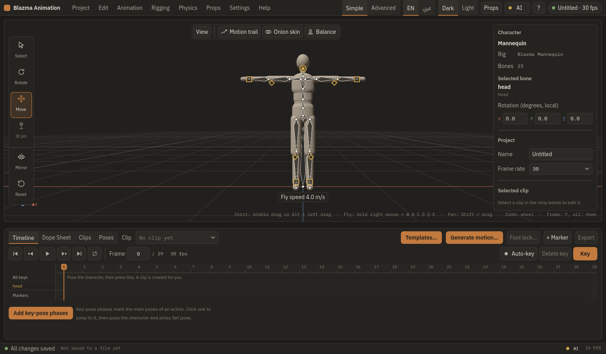
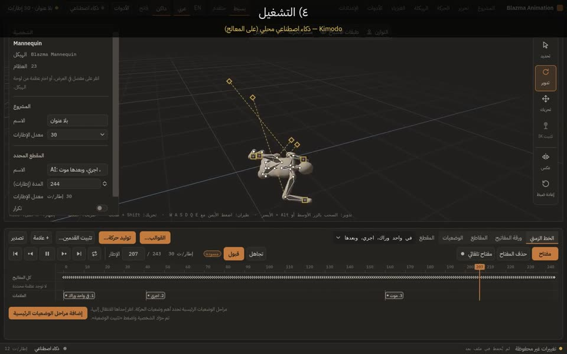
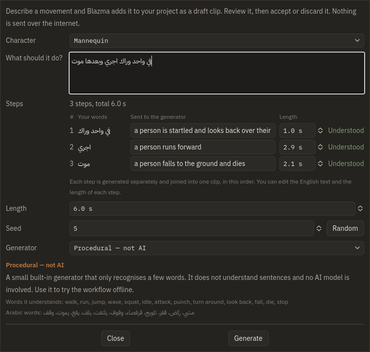
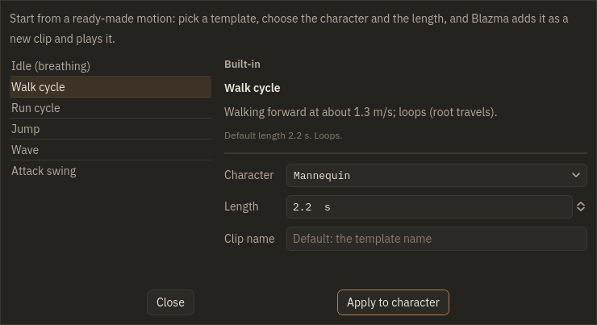
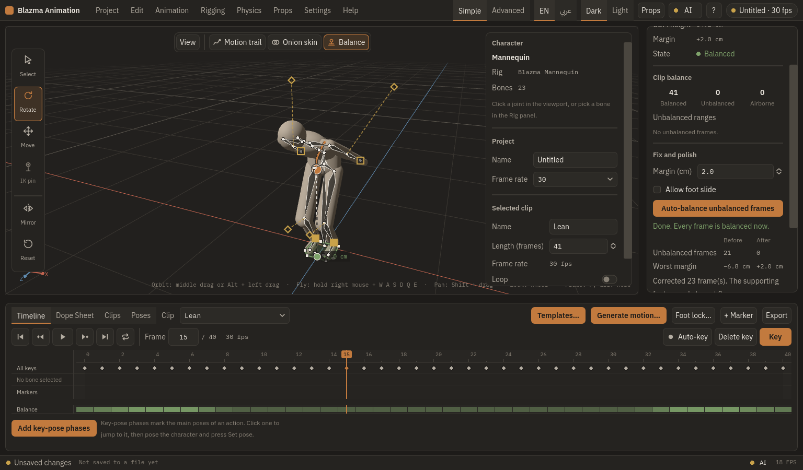
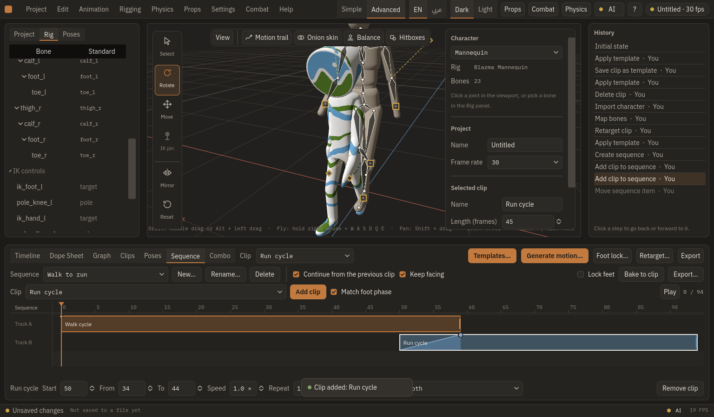
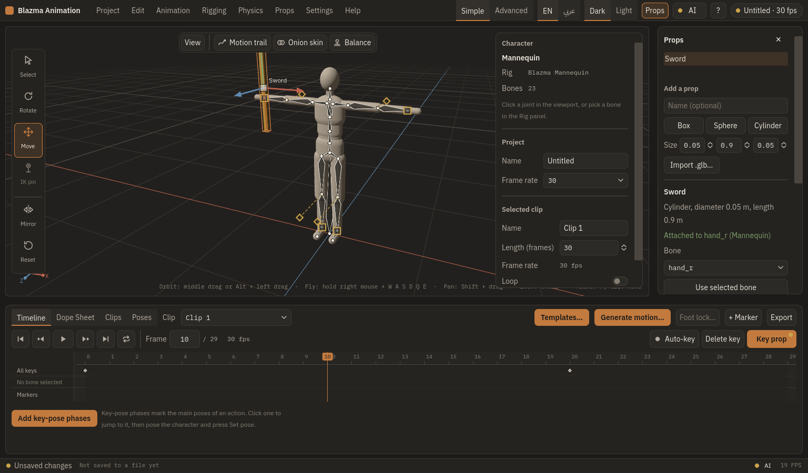
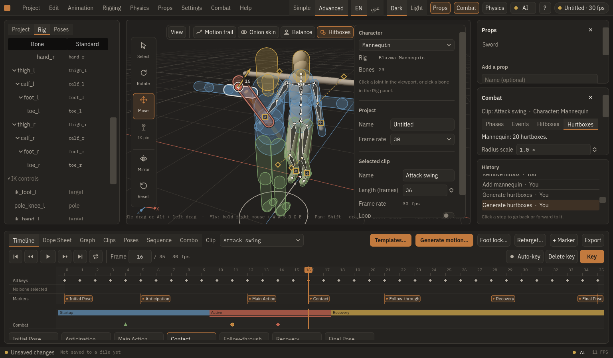
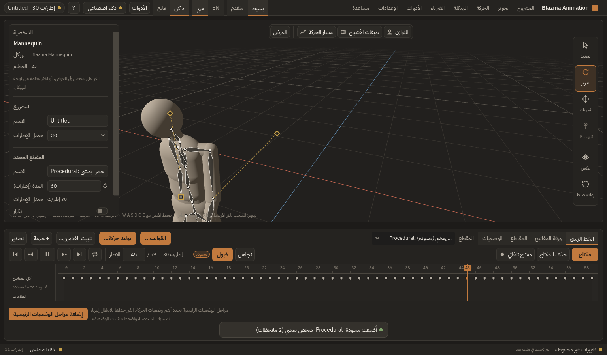
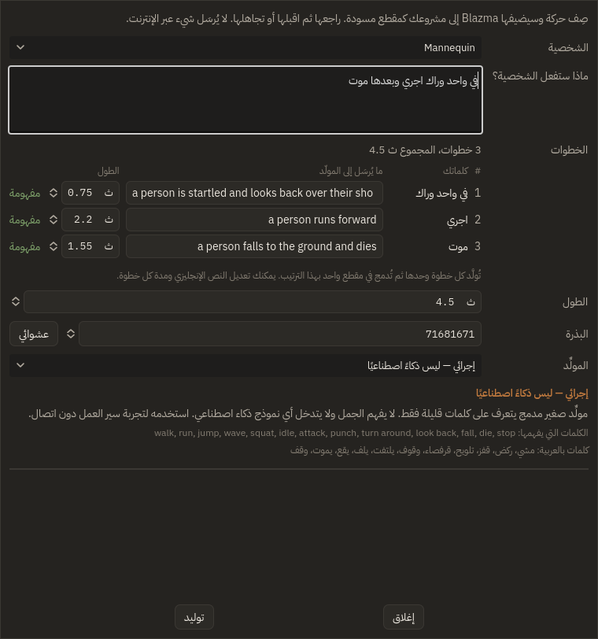

# Blazma Animation

**A 3D character animation studio for your desktop: pose, key, or just describe the motion in words.**

[Download](https://github.com/mr-kateba/blazma-Animation/releases) · [English guide](docs/GUIDE_EN.md) · [الدليل العربي](docs/GUIDE_AR.md)

Version 1.0.0 · Windows 10/11 x64 (Linux x64 also available)

*Watch: «في واحد وراك، اجري، وبعدها موت» becomes a three-step animation, generated on a CPU.*
[Demo 1](docs/videos/demo-1.mp4) · [Demo 2](docs/videos/demo-2.mp4) · [Demo 3](docs/videos/demo-3.mp4) · [Demo 4](docs/videos/demo-4.mp4)

---

## English

Blazma Animation lets you create game-ready character animation without a steep learning curve. Pose a built-in mannequin or your own humanoid model, set keys on a timeline, start from a template, or **type what the character should do** (in English or Arabic) and let the on-device AI model draft the motion for you. When you are happy, export a `.glb` file plus a JSON sidecar for Godot, Unity, Unreal and other tools.

The interface is available in **English and Arabic (right-to-left)**, with dark and light themes and a **Simple** mode for beginners and an **Advanced** mode for power users.

### Key features

<table>
<tr>
<td width="50%" valign="top">

**Text to motion.** Describe a movement, even in several steps, in Arabic or English. Blazma plans the steps, generates each one with the Kimodo model running locally, and gives you an editable draft to accept or discard.

</td>
<td width="50%" valign="top">

**Pose and animate.** FK and IK posing, mirror, a pose library, a timeline with a dope sheet and graph editor, markers, looping and ready-made templates (idle, walk, run, jump, wave, attack).

</td>
</tr>
<tr>
<td valign="top">

**Physics assistance.** See balance (centre of mass and support polygon) on every frame, auto-balance unbalanced poses, and add secondary motion.

</td>
<td valign="top">

**Retarget and blend.** Import a humanoid `.glb` with automatic bone mapping, copy motion between characters, lock the feet, and chain clips with smooth blends.

</td>
</tr>
<tr>
<td valign="top">

**Props.** Attach a sword or any object to a hand and animate it with the character.

</td>
<td valign="top">

**Combat tools.** Attack phases, hitboxes, hurtboxes, a hit test, reactions and combos, all exported with your animation.

</td>
</tr>
</table>

Also: export to **GLB with a JSON sidecar** (events, markers, loop, root motion, combat data), in-place root motion, autosave with crash recovery, a portable mode, and optional control by external AI tools through **MCP or a command line**.

### Download and install

Get the latest build from the **[Releases page](https://github.com/mr-kateba/blazma-Animation/releases)**.

| | Installer (recommended) | Portable |
|---|---|---|
| File | `BlazmaAnimation-<version>-setup.exe` | `BlazmaAnimation-<version>-win64.zip` |
| Administrator rights | Not needed | Not needed |
| Settings stored in | `%APPDATA%\BlazmaAnimation` | `userdata` next to the program |

- **SmartScreen:** the app is not digitally signed yet. If Windows shows "Windows protected your PC", click **More info**, then **Run anyway**. You can verify the download with `SHA256SUMS.txt`.
- **Visual C++ runtime:** AI motion generation needs the Microsoft Visual C++ 2015–2022 x64 runtime. The installer installs it if it is missing. With the portable zip, install it once from <https://aka.ms/vs/17/release/vc_redist.x64.exe> (the error "MSVCP140.dll was not found" means it is missing).
- Linux x64: `.tar.gz` and `AppImage` are on the same page.

### System requirements

| | Recommended | Notes |
|---|---|---|
| OS | Windows 10 or 11, 64-bit | Linux x64 also supported |
| CPU / RAM | A modern 64-bit CPU, 8 GB RAM or more | For animating and exporting. AI generation needs more RAM (below) |
| Graphics | Any GPU with OpenGL support | Used for the 3D view |
| Disk | Space for the app and your projects | Plus 6.2 to 16.3 GB if you use text-to-motion |

**AI motion generation is optional and runs entirely on your computer.** A graphics card is optional: **NVIDIA (CUDA)** or **any Vulkan GPU** (NVIDIA, AMD, Intel) makes it much faster, and the CPU works too. Choose a model package that fits your PC (downloaded in one click from the app, with a resumable download):

| Package | Download size | RAM (min / recommended) | GPU memory (min / recommended) |
|---|---|---|---|
| Light | **6.2 GB** | 7.5 / 16 GB | 6 / 8 GB |
| Standard | **9.3 GB** | 12 / 16 GB | 8 / 12 GB |
| Reference | **16.3 GB** | 20 / 32 GB | 16 / 20 GB |

### Quick start (5 steps)

1. **Install** Blazma Animation and open it. On the first launch it picks your system language (Arabic or English) and offers a two-minute interactive tutorial (the **?** button reopens it). A mannequin is waiting for you.
2. **Pose it:** click a joint, rotate it with the gizmo, and press **Key**. Or press **Templates…** and apply *Walk cycle*.
3. **Generate (optional):** open **Settings > AI Models…** and download a package, then press **Generate motion…** and type, for example, `يقفز ثم يجري للأمام ثم يقف` or `a person walks forward, then waves`. **Accept** the draft you like.
4. **Polish:** use **Foot lock…**, the dope sheet or the graph editor, and the **Balance** view.
5. **Export:** press **Ctrl+E**, pick *In place* root motion if your engine moves the character, and save the `.glb` (with its sidecar).

**Shortcuts:** **F1** shows every keyboard shortcut (searchable, printable); change any of them in **Settings > Keyboard Shortcuts…**. Common keys: **Space** play, **K** key, **Ctrl+G** generate motion, **Ctrl+T** templates, **Ctrl+Z** undo, **F** frame, **Shift+F1** tutorial.

### Guides

- **[User guide (English)](docs/GUIDE_EN.md)**
- **[دليل المستخدم (العربية)](docs/GUIDE_AR.md)**
- [Connecting external AI tools over MCP / CLI](docs/AGENT_SETUP_AR.md) (Arabic) · [MCP tools](docs/MCP_TOOLS.md) · [CLI reference](docs/CLI_REFERENCE.md)
- [Windows setup](docs/WINDOWS_SETUP.md) · [Releasing](docs/RELEASING.md) · [Project status](docs/STATUS.md) · [Changelog](CHANGELOG.md) · [Feature matrix](docs/FEATURE_MATRIX.md)
- Technical documents: [Architecture](docs/ARCHITECTURE.md) · [Data format](docs/DATA_FORMAT.md) · [AI integration](docs/AI_INTEGRATION.md) · [Decisions](docs/DECISIONS.md)

---

## العربية

Blazma Animation استوديو لتحريك الشخصيات ثلاثية الأبعاد على سطح المكتب، يمكّنك من صنع حركة جاهزة للألعاب دون منحنى تعلّم صعب. حرّك المجسّم المدمج أو شخصيتك البشرية، وحدّد المفاتيح على الخط الزمني، أو ابدأ من قالب جاهز، أو **اكتب ما يجب أن تفعله الشخصية** (بالعربية أو الإنجليزية) ودع نموذج الذكاء الاصطناعي الذي يعمل على جهازك يسوّد لك الحركة. وحين ترضى عنها صدّر ملف `.glb` مع ملف JSON مرافق لـGodot وUnity وUnreal وغيرها.

الواجهة متاحة **بالعربية (من اليمين إلى اليسار) وبالإنجليزية**، بسمتين داكنة وفاتحة، ووضع **بسيط** للمبتدئين ووضع **متقدم** للمحترفين.

### أهم الميزات

- **من النص إلى حركة:** صف الحركة، حتى لو من عدة خطوات، بالعربية أو الإنجليزية. يخطّط Blazma الخطوات ويولّد كلًّا منها بنموذج Kimodo على جهازك، ثم تقبل المسودة أو تتجاهلها بعد تعديلها.
- **التحريك:** وضعيات FK وIK، عكس الوضعية، مكتبة وضعيات، خط زمني مع ورقة مفاتيح ومحرر منحنيات وعلامات وتكرار، وقوالب جاهزة (وقوف، مشي، ركض، قفز، تلويح، ضربة).
- **مساعدة الفيزياء:** عرض التوازن (مركز الكتلة ومنطقة الارتكاز) في كل إطار، وموازنة تلقائية، وحركة ثانوية.
- **إعادة التوجيه والدمج:** استيراد `.glb` بشري مع مطابقة عظام تلقائية، ونسخ الحركة بين الشخصيات، وتثبيت القدمين، وربط المقاطع بانتقالات ناعمة.
- **الأدوات (Props):** اربط سيفًا أو أي جسم باليد وحرّكه مع الشخصية.
- **أدوات القتال:** مراحل الهجوم وصناديق الضرب والإصابة واختبار الضرب وردود الفعل والكومبو، وتُصدَّر كلها مع الحركة.
- **التصدير:** GLB مع ملف JSON مرافق (أحداث، علامات، تكرار، حركة الجذر، بيانات القتال)، مع خيار حركة الجذر «في المكان»، وحفظ تلقائي مع استعادة بعد الانهيار، ووضع محمول، وتحكّم اختياري بأدوات ذكاء اصطناعي خارجية عبر **MCP أو سطر الأوامر**.

### التنزيل والتثبيت

نزّل أحدث إصدار من **[صفحة الإصدارات](https://github.com/mr-kateba/blazma-Animation/releases)**.

| | المثبّت (موصى به) | النسخة المحمولة |
|---|---|---|
| الملف | `BlazmaAnimation-<الإصدار>-setup.exe` | `BlazmaAnimation-<الإصدار>-win64.zip` |
| صلاحيات المدير | غير لازمة | غير لازمة |
| مكان الإعدادات | `%APPDATA%\BlazmaAnimation` | `userdata` بجانب البرنامج |

- **SmartScreen:** البرنامج غير موقَّع رقميًا بعد. إن ظهرت «Windows protected your PC» فاضغط **More info** ثم **Run anyway**. ويمكنك التحقق من الملف بمقارنته مع `SHA256SUMS.txt`.
- **وقت تشغيل Visual C++:** توليد الحركة يحتاج Microsoft Visual C++ 2015–2022 x64. المثبّت يثبّته إن غاب. وفي النسخة المحمولة ثبّته مرة واحدة من <https://aka.ms/vs/17/release/vc_redist.x64.exe> (الخطأ «MSVCP140.dll was not found» يعني أنه غير موجود).
- نسخ Linux x64 (`.tar.gz` وAppImage) في الصفحة نفسها.

### متطلبات النظام

| | الموصى به | ملاحظات |
|---|---|---|
| نظام التشغيل | Windows 10 أو 11 (64 بت) | وLinux x64 مدعوم أيضًا |
| المعالج / الذاكرة | معالج 64 بت حديث، وذاكرة 8 GB أو أكثر | للتحريك والتصدير. توليد الذكاء الاصطناعي يحتاج ذاكرة أكبر (أدناه) |
| الرسوميات | أي بطاقة تدعم OpenGL | للعرض ثلاثي الأبعاد |
| القرص | مساحة للبرنامج ومشاريعك | إضافة 6.2 إلى 16.3 GB إن استعملت التوليد من النص |

**توليد الحركة بالذكاء الاصطناعي اختياري ويعمل بالكامل على جهازك.** بطاقة الرسوميات اختيارية: بطاقة **NVIDIA (CUDA)** أو **أي بطاقة تدعم Vulkan** (NVIDIA وAMD وIntel) تسرّعه كثيرًا، والمعالج يكفي أيضًا. اختر حزمة نموذج تناسب جهازك (تُنزَّل بضغطة واحدة من البرنامج مع إمكانية استئناف التنزيل):

| الحزمة | حجم التنزيل | الذاكرة (أدنى / موصى) | ذاكرة البطاقة (أدنى / موصى) |
|---|---|---|---|
| خفيفة | **6.2 GB** | 7.5 / 16 GB | 6 / 8 GB |
| قياسية | **9.3 GB** | 12 / 16 GB | 8 / 12 GB |
| مرجعية | **16.3 GB** | 20 / 32 GB | 16 / 20 GB |

### بداية سريعة (5 خطوات)

1. **ثبّت** Blazma Animation وافتحه. في أول تشغيل يختار لغة نظامك (العربية أو الإنجليزية) ويعرض شرحًا تفاعليًا من دقيقتين (زر **؟** يعيد فتحه). المجسّم بانتظارك.
2. **حرّكه:** انقر مفصلًا وأدِره بالمقبض واضغط **مفتاح**. أو اضغط **القوالب…** وطبّق *مشية*.
3. **ولّد (اختياري):** افتح **الإعدادات ← نماذج الذكاء الاصطناعي…** ونزّل حزمة، ثم اضغط **توليد حركة…** واكتب مثلًا `يقفز ثم يجري للأمام ثم يقف` أو «في واحد وراك، اجري، وبعدها موت». **اقبل** المسودة التي تعجبك.
4. **صقل:** استعمل **تثبيت القدمين…** أو ورقة المفاتيح أو الرسم البياني، وعرض **التوازن**.
5. **صدّر:** اضغط **Ctrl+E**، واختر حركة الجذر «في المكان» إن كان محركك يحرّك الشخصية، واحفظ ملف `.glb` (مع ملفه المرافق).

**الاختصارات:** **F1** يعرض كل اختصارات لوحة المفاتيح (مع بحث وطباعة)، ويمكنك تغيير أي منها من **الإعدادات ← اختصارات لوحة المفاتيح…**. أشهرها: **Space** تشغيل، **K** مفتاح، **Ctrl+G** توليد حركة، **Ctrl+T** القوالب، **Ctrl+Z** تراجع، **F** إظهار المحدد، **Shift+F1** الشرح.

### الأدلة

- **[دليل المستخدم (العربية)](docs/GUIDE_AR.md)**
- **[User guide (English)](docs/GUIDE_EN.md)**
- [ربط أدوات الذكاء الاصطناعي الخارجية عبر MCP / CLI](docs/AGENT_SETUP_AR.md) · [أدوات MCP](docs/MCP_TOOLS.md) · [مرجع CLI](docs/CLI_REFERENCE.md)
- [التشغيل على Windows](docs/WINDOWS_SETUP.md) · [إصدار نسخة](docs/RELEASING.md) · [حالة المشروع](docs/STATUS.md) · [سجل التغييرات](CHANGELOG.md) · [مصفوفة الميزات](docs/FEATURE_MATRIX.md)
- وثائق تقنية: [المعمارية](docs/ARCHITECTURE.md) · [صيغة البيانات](docs/DATA_FORMAT.md) · [تكامل الذكاء الاصطناعي](docs/AI_INTEGRATION.md) · [القرارات](docs/DECISIONS.md)

---

## Licence / الترخيص

Copyright (c) 2025-2026 mr-kateba. All rights reserved. Blazma Animation is proprietary software; see [LICENSE](LICENSE). Third-party components bundled with a release keep their own licences (see `THIRD_PARTY_NOTICES.md` in the release).

جميع الحقوق محفوظة لـ mr-kateba. البرنامج مملوك؛ انظر [LICENSE](LICENSE). المكوّنات الخارجية المضمّنة في الإصدار تحتفظ بتراخيصها.
