<div dir="rtl">

# Blazma Animation — دليل المستخدم (العربية)

[English](GUIDE_EN.md) · [العودة إلى README](../README.md)

Blazma Animation استوديو لتحريك الشخصيات ثلاثية الأبعاد على سطح المكتب. تضع الشخصية في وضعية، وتحدد مفاتيح على الخط الزمني، أو تصف الحركة بكلماتك فقط، ثم تصدّر ملف `.glb` تفتحه محركات الألعاب (Godot وUnity وUnreal عبر glTF) ومعظم برامج الثلاثي الأبعاد. يشرح هذا الدليل كل جزء من البرنامج خطوة بخطوة، ويخص الإصدار **0.12.0**.

> **لغة البرنامج:** الواجهة متاحة بالعربية (من اليمين إلى اليسار) وبالإنجليزية. بدّل بينهما في أي وقت بالزرّين **EN / عربي** في الشريط العلوي. كل لقطات الشاشة في هذا الدليل حقيقية من البرنامج نفسه، ويظهر بعضها بالواجهة الإنجليزية لأنها الأوضح؛ والتسميات العربية مذكورة في النص.

## المحتويات

1. [التثبيت والتشغيل الأول](#1-التثبيت-والتشغيل-الأول)
2. [جولة في الواجهة](#2-جولة-في-الواجهة)
3. [التحكم بالكاميرا](#3-التحكم-بالكاميرا)
4. [تحريك الشخصية (الوضعيات)](#4-تحريك-الشخصية-الوضعيات)
5. [الخط الزمني والمفاتيح](#5-الخط-الزمني-والمفاتيح)
6. [القوالب الجاهزة](#6-القوالب-الجاهزة)
7. [توليد الحركة من نص](#7-توليد-الحركة-من-نص)
8. [الفيزياء: التوازن والحركة الثانوية](#8-الفيزياء-التوازن-والحركة-الثانوية)
9. [استيراد الشخصيات وإعادة التوجيه](#9-استيراد-الشخصيات-وإعادة-التوجيه)
10. [تثبيت القدمين](#10-تثبيت-القدمين)
11. [التسلسلات والدمج](#11-التسلسلات-والدمج)
12. [الأدوات (Props)](#12-الأدوات-props)
13. [أدوات القتال](#13-أدوات-القتال)
14. [التصدير إلى محركات الألعاب](#14-التصدير-إلى-محركات-الألعاب)
15. [الحفظ والحفظ التلقائي والاستعادة](#15-الحفظ-والحفظ-التلقائي-والاستعادة)
16. [ربط أدوات الذكاء الاصطناعي الخارجية (MCP / CLI)](#16-ربط-أدوات-الذكاء-الاصطناعي-الخارجية-mcp--cli)
17. [حل المشكلات والأسئلة الشائعة](#17-حل-المشكلات-والأسئلة-الشائعة)
18. [مرجع لوحة المفاتيح والفأرة](#18-مرجع-لوحة-المفاتيح-والفأرة)

---

## 1. التثبيت والتشغيل الأول

نزّل أحدث إصدار من [صفحة الإصدارات (Releases)](https://github.com/mr-kateba/blazma-Animation/releases). المنصة الأساسية Windows 10 و11 (64 بت)، وتتوفر أيضًا نسخ Linux x64 (`.tar.gz` وAppImage).

### المثبّت أم النسخة المحمولة؟

| | المثبّت | النسخة المحمولة |
|---|---|---|
| الملف | `BlazmaAnimation-<الإصدار>-setup.exe` | `BlazmaAnimation-<الإصدار>-win64.zip` |
| يحتاج صلاحيات مدير | لا (يُثبَّت للمستخدم الحالي) | لا |
| قائمة Start وبرنامج إزالة | نعم | لا |
| ربط ملفات `.blazanim` | نعم (اختياري) | لا |
| مكان الإعدادات | `%APPDATA%\BlazmaAnimation` | مجلد `userdata` بجانب البرنامج |
| الأنسب لـ | جهازك الشخصي | فلاش أو تجربة سريعة |

**المثبّت:** شغّله واختر المكوّنات (البرنامج، وربط ملفات `.blazanim`، واختصار سطح المكتب اختياريًا) ثم أكمل. يُثبَّت في `%LOCALAPPDATA%\Programs\BlazmaAnimation`. للإزالة: Settings ← Apps، أو `uninstall.exe` في مجلد التثبيت. تبقى إعداداتك، ويسألك المزيل هل تريد حذف نماذج الذكاء الاصطناعي المنزّلة (الافتراضي: الإبقاء عليها).

**المحمولة:** فك الضغط في أي مجلد وشغّل `BlazmaAnimation.exe`. وجود الملف `portable.txt` بجانب البرنامج يفعّل الوضع المحمول، فتُحفظ الإعدادات والحفظ التلقائي في مجلد `userdata` بجانب البرنامج بدل `%APPDATA%`. احذف `portable.txt` لإلغاء الوضع المحمول.

لا يحتاج أي منهما إلى تثبيت .NET أو Godot.

### تحذير Windows SmartScreen

البرنامج غير موقَّع رقميًا بعد، لذلك قد يعرض Windows الرسالة «Windows protected your PC». اضغط **More info** ثم **Run anyway**. للتأكد من سلامة الملف قارن بصمته مع `SHA256SUMS.txt` في صفحة الإصدار:

```
certutil -hashfile BlazmaAnimation-<الإصدار>-setup.exe SHA256
```

### وقت تشغيل Visual C++ (لازم لتوليد الحركة)

محرّك توليد الحركة (`kimodo-runner.exe`) يحتاج إلى *Microsoft Visual C++ 2015–2022 x64 Runtime*. **المثبّت** يتحقق من وجوده ويثبّته لك (يطلب Windows موافقة المدير لهذه الخطوة فقط). في **النسخة المحمولة** ثبّته بنفسك مرة واحدة من <https://aka.ms/vs/17/release/vc_redist.x64.exe>. إن غاب ستظهر عند التوليد رسالة «MSVCP140.dll was not found»، وبقية البرنامج تعمل بلا مشكلة.

### أول تشغيل

في أول مرة تشغّل فيها بلازما ينظر البرنامج إلى لغة جهازك ويفتح شاشة **الترحيب**. الأجهزة العربية (أي منطقة عربية) تختار **العربية** مسبقًا، وغيرها تختار **English**؛ اختر اللغة والسمة **الداكنة** أو **الفاتحة** ثم اضغط **متابعة**. يُحفظ اختيارك ولا تظهر الشاشة مرة أخرى. يمكنك تغيير اللغة والسمة في أي وقت من الشريط العلوي أو من **الإعدادات**، وإعادة فتح الشاشة من **الإعدادات ← الترحيب**.

بعدها يعرض البرنامج **شرحًا تعليميًا تفاعليًا** من دقيقتين («كيف يعمل بلازما»): يعتّم النافذة ويضيء الأزرار الحقيقية واحدًا بعد الآخر مع بطاقة قصيرة لكل خطوة: منطقة العرض والكاميرا، وتحديد العظام وتحريكها (FK وIK)، والمفاتيح على الخط الزمني، والقوالب، و**توليد حركة…** بجملة متعددة الخطوات مع جدول الخطة، والمسودات (قبول أو تجاهل)، وعرض التوازن، والتصدير والحفظ. خطوة اختيارية تتيح لك التجربة: تضيف قالب المشي وتشغّله. استعمل **التالي** / **السابق** أو **تخطَّ** أو **Esc**. وزر **؟** في الشريط العلوي و**مساعدة ← الشرح** (Shift+F1) يفتحانه متى شئت.

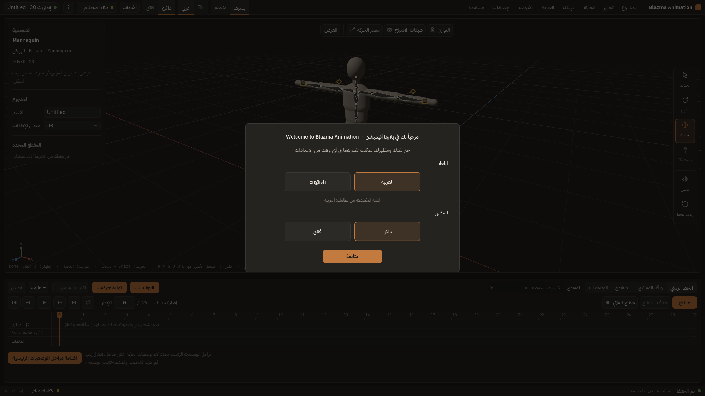

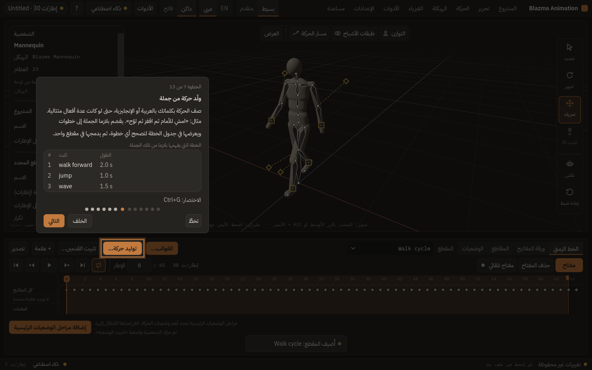

#### أول مشروع

يفتح البرنامج على مشروع فيه شخصية **Mannequin** (مجسّم بشري مدمج) واقفة بوضعية T، وخط زمني فارغ، والواجهة **البسيطة**. لا يلزم أي إعداد. حرّك المجسّم واضغط **مفتاح** (القسم 4)، أو اضغط **القوالب…** لتحصل فورًا على مشية (القسم 6).

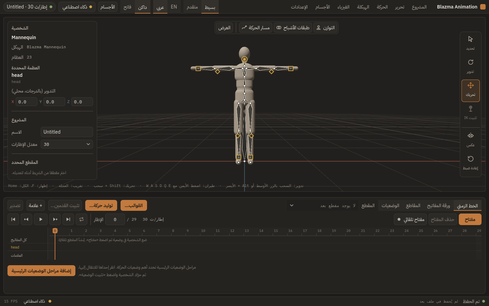

---

## 2. جولة في الواجهة

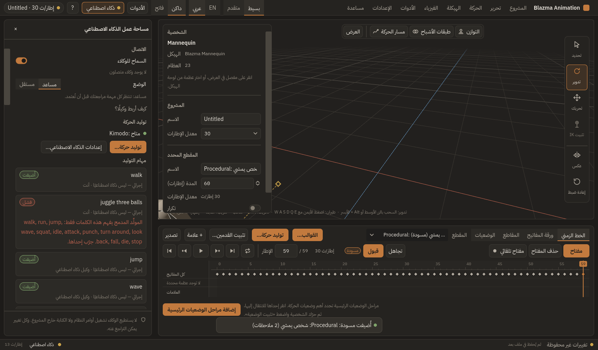

من الأعلى إلى الأسفل:

- **شريط القوائم:** المشروع، تحرير، الحركة، الهيكلة، الفيزياء، الأدوات (Props)، الإعدادات، وفي الوضع المتقدم القتال.
- **أزرار الشريط العلوي:** مفتاح **بسيط / متقدم**، ومفتاح اللغة **EN / عربي**، ومفتاح السمة **داكن / فاتح**، وأزرار اللوحات (الأدوات، القتال، الفيزياء، ذكاء اصطناعي)، واسم المشروع ومعدل الإطارات.
- **العرض ثلاثي الأبعاد (الوسط):** المسرح. شريط الأدوات الجانبي فيه: تحديد، تدوير، تحريك، تثبيت IK، عكس، إعادة ضبط. والشريط فوق العرض يبدّل **مسار الحركة** و**طبقات الأشباح** و**التوازن** (و**صناديق الضرب** في الوضع المتقدم) ويفتح قائمة **العرض**.
- **المفتش (بجانب العرض):** خصائص الشخصية والعظمة والمشروع والمقطع المحدد.
- **اللوحة السفلية:** تبويبات **الخط الزمني** و**ورقة المفاتيح** و**المقاطع** و**الوضعيات** (و**الرسم البياني** و**التسلسل** و**الكومبو** في الوضع المتقدم)، مع أزرار التشغيل والتكرار وزر **مفتاح** وأزرار الإجراءات: **القوالب…** و**توليد حركة…** و**تثبيت القدمين…** و**إعادة توجيه…** و**تصدير**.
- **شريط الحالة:** حالة الحفظ («تغييرات غير محفوظة» / «تم الحفظ»)، ومسار ملف المشروع، ومؤشر الذكاء الاصطناعي.

### بسيط أم متقدم؟

**البسيط** يعرض ما تحتاجه للتحريك والتوليد والتصدير فقط. **المتقدم** يضيف شجرة **الهيكل** وبنية المشروع على جانب، وقائمة **السجل** على الجانب الآخر، وتبويبات إضافية (الرسم البياني، التسلسل، الكومبو) وقائمة القتال. التبديل بين الوضعين يخفي اللوحات أو يُظهرها فقط؛ كل الميزات تعمل في الوضعين ولا يتغير عملك.

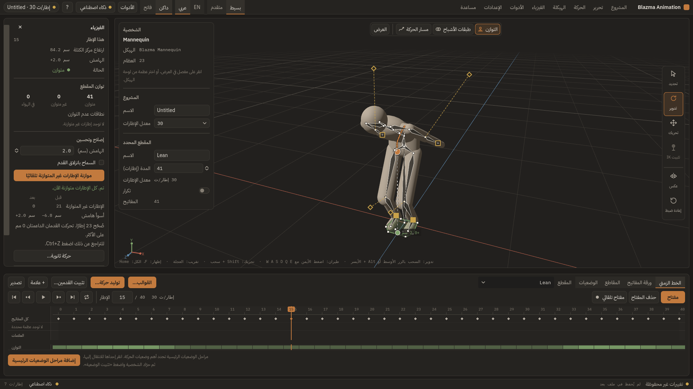

### اللغة والسمة

اضغط **EN** أو **عربي** في الشريط العلوي. اختيار العربية يقلب التخطيط كله من اليمين إلى اليسار، بما فيه اللوحات وتسميات الخط الزمني. أما الخط الزمني نفسه فيمتد دائمًا من اليسار إلى اليمين كما في كل برامج التحريك. **داكن** و**فاتح** يغيّران السمة.

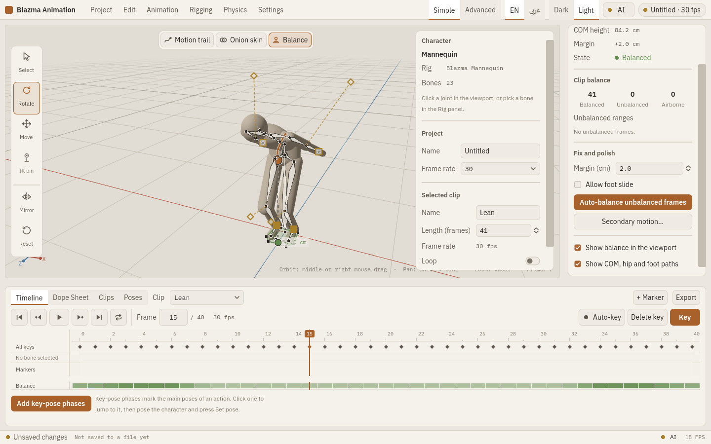

### التراجع والإعادة

**Ctrl+Z** للتراجع و**Ctrl+Y** (أو Ctrl+Shift+Z) للإعادة. في الوضع المتقدم تعرض قائمة **السجل** كل الخطوات، وبالنقر على أي خطوة ترجع إليها أو تتقدم نحوها.

---

## 3. التحكم بالكاميرا

تستطيع الطيران داخل المشهد كما في محررات الألعاب، أو التدوير حول الشخصية.


| الإجراء | التحكم |
|---|---|
| **الطيران** | اضغط **زر الفأرة الأيمن** باستمرار، ثم حرّك الفأرة للنظر واضغط **W A S D** للحركة |
| نزولًا / صعودًا أثناء الطيران | **Q** / **E** |
| أسرع / أبطأ أثناء الطيران | **Shift** (نحو 3 أضعاف) / **Ctrl** (ربع السرعة) |
| تغيير سرعة الطيران | عجلة الفأرة أثناء الطيران (يظهر إشعار بالسرعة، من 0.5 إلى 40 م/ث) |
| **التدوير** | زر الفأرة **الأوسط** مع السحب، أو **Alt + الزر الأيسر** مع السحب |
| التحريك الجانبي (Pan) | **Shift** + سحب |
| التقريب والتبعيد | عجلة الفأرة |
| إظهار المحدد | **F** أو **.** في لوحة الأرقام |
| عرض الكل | **Home** |
| عرض أمامي / جانبي / علوي | **1** / **3** / **7** في لوحة الأرقام (مع **Ctrl** للجهة المقابلة) |
| منظور / متعامد | **5** في لوحة الأرقام |

> أثناء تركيز العرض ثلاثي الأبعاد تختار **W** و**E** و**Q** أيضًا أدوات التحريك والتدوير والتحديد. ولا تحرّك الكاميرا إلا والزر الأيمن مضغوط.

### قائمة «العرض»

زر **العرض** في الشريط فوق المسرح يسرد الأوامر نفسها مع اختصاراتها، إضافة إلى **إعادة ضبط الكاميرا** ومنزلق **سرعة الكاميرا**.

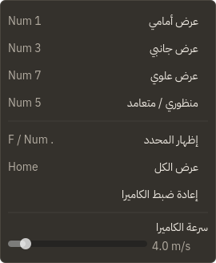

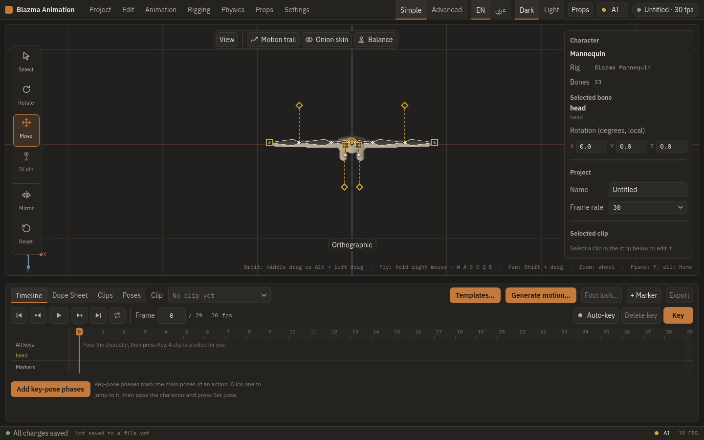

### إعدادات الكاميرا

**الإعدادات ← إعدادات الكاميرا…** تضبط سرعة الطيران، ومجال الرؤية (من 30 إلى 100)، و**عكس النظر العمودي**، و**التدوير حول العظمة المحددة** (تدور الكاميرا حول العظمة التي حددتها بدل مركز المشهد).

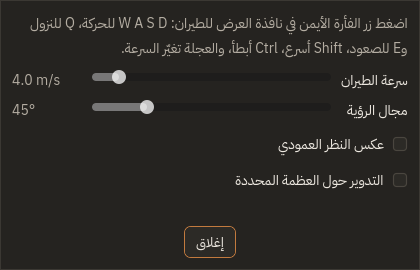

---

## 4. تحريك الشخصية (الوضعيات)

### التحديد والتدوير والتحريك

1. انقر مفصلًا على الشخصية، أو اختر عظمة من شجرة **الهيكل** (الوضع المتقدم). يظهر اسمها ودورانها المحلي في المفتش، ويمكنك كتابة قيم دقيقة هناك.
2. اختر أداة من الشريط الجانبي: **تحديد (Q)** أو **تدوير (E)** أو **تحريك (W)**، واسحب المقبض لتحريك العظمة. هذا هو **FK** (الحركة الأمامية): تدوّر كل مفصل بنفسك.
3. اضغط **مفتاح** (أو فعّل **مفتاح تلقائي** ليُسجَّل كل تغيير) لتخزين الوضعية عند الإطار الحالي. إن لم يوجد مقطع يُنشأ واحد تلقائيًا.

### IK: تثبيت اليدين والقدمين

المعيّنات الصغيرة قرب اليدين والقدمين هي أهداف IK. حدد يدًا أو قدمًا واضغط **Shift+P** (أو أداة **تثبيت IK**، أو من قائمة الهيكلة: *تثبيت اليد أو القدم المحددة*) لـ**تثبيتها**: يتبع الطرف الهدف، فتبقى القدم المثبتة في مكانها وأنت تحرّك الحوض. حرّك الهدف فيتبعه الذراع أو الساق كلها (IK ثنائي العظام، مع هدف قطبي لتوجيه المرفق أو الركبة). **الهيكلة ← تثبيت القدمين** تثبّت القدمين معًا، و**إلغاء كل التثبيت** يحررهما.

### العكس (Mirror)

**عكس (M)** يقلب الوضعية من اليسار إلى اليمين. استعمله لتحويل تلويح اليد اليمنى إلى اليسرى، أو لبناء النصف الثاني من المشي من الأول. **إعادة ضبط** تعيد العظمة المحددة أو الوضعية كلها إلى وضع الراحة.

### النسخ واللصق ومكتبة الوضعيات

- **Ctrl+C / Ctrl+V** تنسخ وتلصق وضعية كاملة بين الإطارات أو المقاطع.
- تبويب **الوضعيات** هو مكتبتك: احفظ الوضعية الحالية باسم، ثم **طبّقها** في أي وقت وعلى أي إطار. يمكن إعادة تسمية الوضعيات وحذفها، وتُحفظ مع ملف المشروع.

---

## 5. الخط الزمني والمفاتيح

### المفاتيح

**المفتاح** يخزّن وضعية العظمة عند إطار واحد، والحركة هي الانتقال بين المفاتيح. صف **كل المفاتيح** يعرض معيّنًا لكل مفتاح في المقطع، والصف الذي تحته يعرض مفاتيح العظمة المحددة.

| الإجراء | الطريقة |
|---|---|
| مفتاح للشخصية كلها | زر **مفتاح** أو **K** |
| مفتاح للعظمة المحددة فقط | **Shift+K** |
| حذف المفتاح هنا | **حذف المفتاح** أو **Alt+K** |
| مفتاح تلقائي | بدّل **مفتاح تلقائي** بجانب زر المفتاح |
| تحريك مؤشر التشغيل | انقر المسطرة، أو **اليسار / اليمين** لإطار واحد، **Home / End** للبداية والنهاية |
| المفتاح السابق / التالي | **السهم الأعلى / الأسفل** (أو Alt+يسار / Alt+يمين) |
| تشغيل / إيقاف مؤقت | **Space** |

### الاستيفاء (Interpolation)

بين مفتاحين قد تكون الحركة:

- **منحنية (Cubic):** بداية ونهاية ناعمتان، وهي الافتراضية للحركة الطبيعية؛
- **خطية (Linear):** بسرعة ثابتة؛
- **ثابتة (Step):** تبقى الوضعية القديمة ثم تقفز، ومناسبة لرسم الوضعيات الأولية.

في **ورقة المفاتيح** حدد المفاتيح، وانقر بالزر الأيمن، واختر **الاستيفاء**.

### ورقة المفاتيح والرسم البياني

**ورقة المفاتيح (Dope Sheet)** تعرض مفاتيح كل عظمة في صفوف. اسحب لنقل المفاتيح، و**Ctrl+C / Ctrl+V** للنسخ واللصق، و**Ctrl+A** لتحديد الكل، و**Delete** للحذف.

تبويب **الرسم البياني (Graph)** (الوضع المتقدم) يعرض كل قناة كمنحنى لتعيد تشكيل الحركة نفسها. اسحب المفاتيح ومقابض المنحنيات في المفاتيح المنحنية، واضغط **F** أو **Home** لإظهار المنحنيات كلها.

### العلامات ومراحل الوضعيات والتكرار

- **+ علامة** تضيف راية باسم عند المؤشر (مثل «التلامس»). تُحفظ العلامات في الملف المرافق عند التصدير.
- **إضافة مراحل الوضعيات الرئيسية** تضيف العلامات الكلاسيكية: الوضعية الأولى، التمهيد، الحركة الرئيسية، التلامس، المتابعة، التعافي، الوضعية النهائية. انقر واحدة لتنتقل إليها، ثم حرّك الشخصية واضغط «مفتاح».
- **تكرار (Loop)** (المفتاح في المفتش وزر التكرار في شريط التشغيل) يجعل المقطع يعيد نفسه، ويمكن أن يكون نطاق التكرار جزءًا من المقطع. المقاطع المتكررة تُصدَّر كدورات سلسة.

### المقاطع

تبويب **المقاطع** يعرض كل مقاطع المشروع بطاقات (الاسم، معدل الإطارات، الطول). انقر للتحديد، وانقر مرتين لإعادة التسمية، و**+ مقطع جديد** للإضافة. والحذف يطلب تأكيدك دائمًا.

---

## 6. القوالب الجاهزة

اضغط **القوالب…** (تحت الخط الزمني) لتبدأ من حركة جاهزة: **وقوف (تنفّس)** و**مشية** و**ركض** و**قفزة** و**تلويح** و**ضربة هجوم**. اختر القالب والشخصية والمدة بالثواني ثم **تطبيق على الشخصية**. يُضاف مقطع جديد ويعمل فورًا، وكله مفاتيح عادية يمكنك تعديلها.

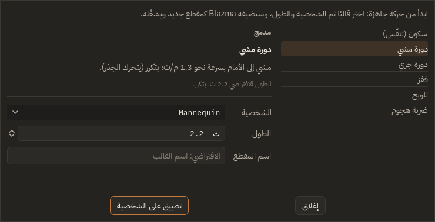

المشية المدمجة مبنية على نموذج لخطوات المشي مع تثبيت القدمين بـIK فلا تنزلق. يقارن الرسم التالي المشية القديمة الخشنة (يسارًا) بالحالية (يمينًا): منحنيات الكاحل والركبة والحوض أنعم بوضوح.

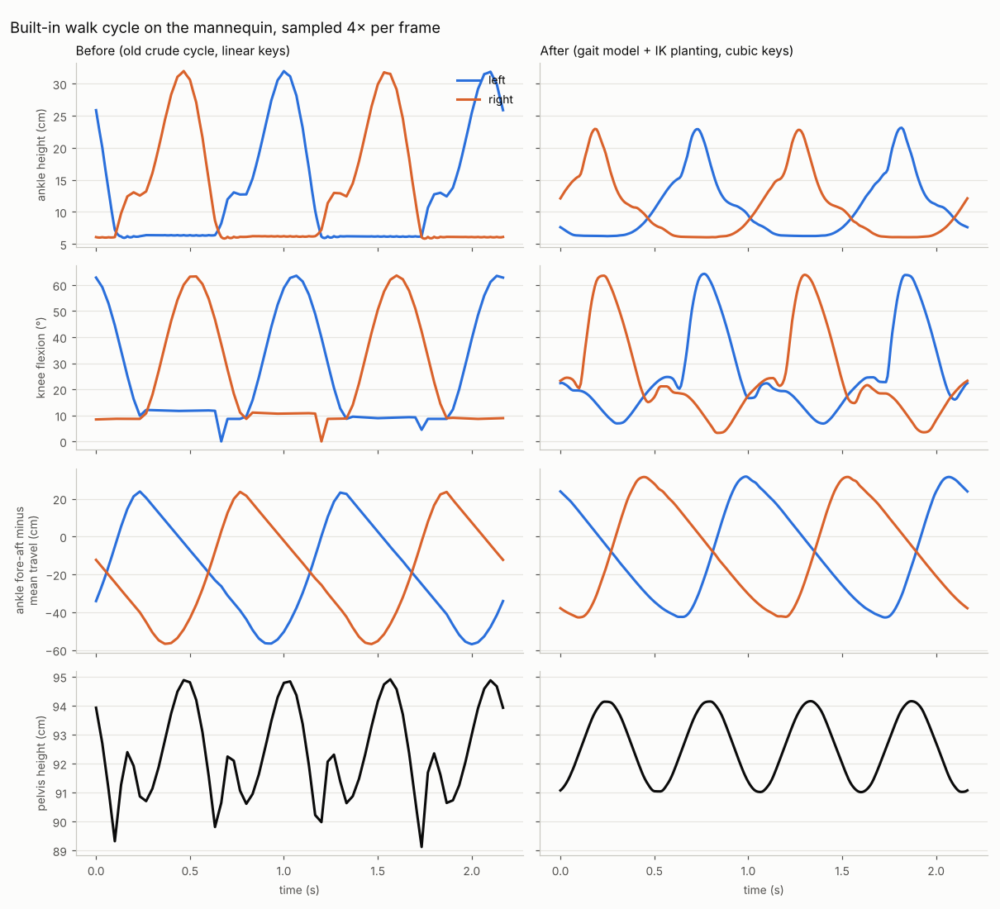

ويمكنك حفظ أي مقطع صنعته كـ**قالب** في مكتبة مشروعك وتطبيقه لاحقًا على شخصية أخرى.

---

## 7. توليد الحركة من نص

صف الحركة بكلمات عادية فيبني Blazma لك مقطعًا مسودة. المولِّد هو **Kimodo**، نموذج ذكاء اصطناعي يعمل **بالكامل على جهازك**. لا يُرسَل شيء عبر الإنترنت، إلا ملفات النموذج حين تقرر تنزيلها.

### الخطوة 1: نزّل نموذجًا (بضغطة واحدة)

افتح **الإعدادات ← نماذج الذكاء الاصطناعي…** (أو اضغط **توليد حركة…** أول مرة).

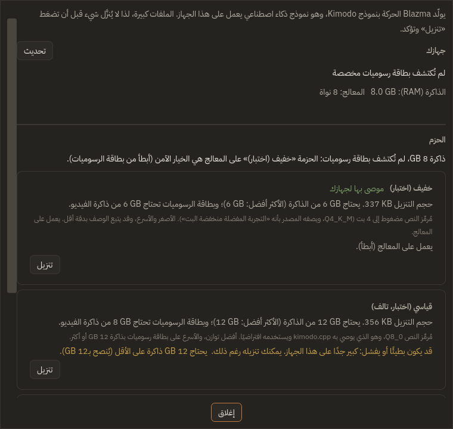

*(أُخذت هذه اللقطة بحزم اختبار صغيرة جدًا، لذلك الأحجام المعروضة صغيرة. الحزم الحقيقية 6.2 و9.3 و16.3 GB.)*

تكتشف النافذة عتاد جهازك (بطاقة الرسوميات والذاكرة والمعالج) و**تقترح** حزمة:

| الحزمة | مُرمِّز النص | حجم التنزيل | الذاكرة (أدنى / موصى) | ذاكرة البطاقة (أدنى / موصى) | تناسب |
|---|---|---|---|---|---|
| **خفيفة (Light)** | Q4_K_M | 6.2 GB | 7.5 / 16 GB | 6 / 8 GB | الأجهزة المتواضعة والمعالج وحده |
| **قياسية (Standard)** | Q8_0 | 9.3 GB | 12 / 16 GB | 8 / 12 GB | بطاقة رسوميات 12 GB فأكثر |
| **مرجعية (Reference)** | BF16 | 16.3 GB | 20 / 32 GB | 16 / 20 GB | الأجهزة القوية جدًا |

الحزم الثلاث تستعمل نموذج الحركة نفسه، وتختلف في حجم مُرمِّز النص. أرقام الذاكرة تقديرية، لذلك تبقى كل حزمة قابلة للاختيار حتى لو حذّرت النافذة من بطء محتمل.

1. اضغط **تنزيل** على الحزمة.
2. اقرأ تراخيص النماذج ووافق عليها (رخصة NVIDIA Open Model لنموذج الحركة، ورخصة Meta Llama 3 المجتمعية لمُرمِّز النص). لا يبدأ Blazma أي تنزيل قبل تأكيدك.
3. انتظر شريط التقدم. التنزيل **يُستأنف** إن انقطع: اضغط «تنزيل» مرة أخرى فيكمل من حيث توقف. ويُتحقق من بصمة SHA-256 لكل ملف بعد التنزيل.

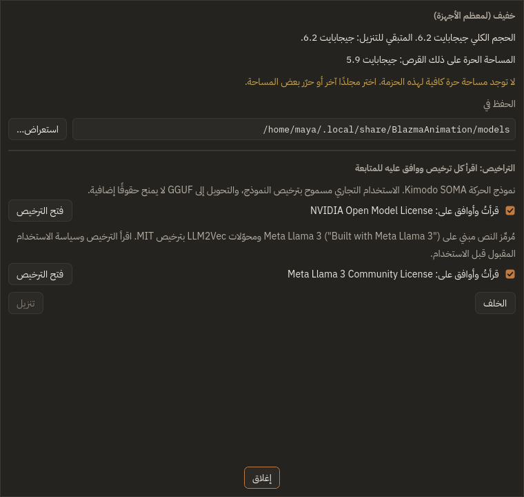 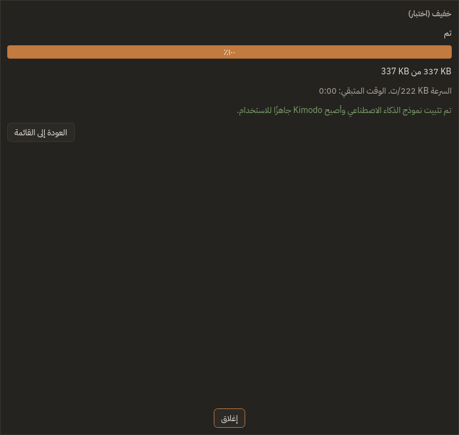

تُحفظ الملفات في `%LOCALAPPDATA%\BlazmaAnimation\models` (أو `userdata\models` في الوضع المحمول). حجمها كبير، لذلك لا توضع في الملف الشخصي المتجوّل.

### الخطوة 2: اختر مكان التشغيل: البطاقة أم المعالج أم كلاهما

من **الإعدادات ← توليد الحركة (ذكاء اصطناعي)…** اختر **الجهاز**:

| الوضع | المعنى |
|---|---|
| **تلقائي (بطاقة الرسوميات أولًا)** | الافتراضي. يجرب CUDA (NVIDIA) ثم أي بطاقة تدعم Vulkan (NVIDIA وAMD وIntel) ثم البطاقة مع مُرمِّز النص على المعالج ثم المعالج وحده. إن فشلت محاولة ينتقل إلى التالية ويخبرك |
| **بطاقة الرسوميات فقط** | يستعمل البطاقة، ويفشل برسالة إن لم تصلح بطاقة |
| **المعالج فقط** | يعمل دائمًا لكنه أبطأ |
| **بطاقة الرسوميات + المعالج** | مُرمِّز النص على المعالج ونموذج الحركة على البطاقة. اخترها حين لا تكفي ذاكرة بطاقتك للحزمة كلها |

زر **فحص** يسرد الأجهزة التي وجدها Blazma. وبعد كل توليد يعرض الناتج سطر **«وُلِّدت على: …»** لتعرف ما الذي اشتغل فعلًا، مع تحذير إن اضطر للانتقال إلى جهاز آخر بعد محاولة فاشلة.

#### اختياري: تسريع بطاقات NVIDIA (CUDA)

كي يبقى المثبّت صغيرًا (نحو 150 ميغابايت بدل نحو 460)، يحمل واجهتَي المعالج وVulkan فقط، وبطاقات NVIDIA تعمل عبر Vulkan مباشرة. لكن CUDA أسرع عادةً على NVIDIA، لذلك حين يكتشف Blazma بطاقة NVIDIA يظهر في **الإعدادات ← توليد الحركة (ذكاء اصطناعي)…** قسم **تسريع بطاقة الرسومات (CUDA)** فيه زر **تنزيل تسريع بطاقة الرسومات (CUDA، نحو 550 MB)**.

- لا يُنزَّل شيء قبل أن تضغط الزر (الوكلاء وأدوات MCP/CLI لا يستطيعون بدءه أبدًا). الملف من إصدار Blazma على GitHub، ويُطابَق مع بصمة SHA-256 المحفوظة داخل البرنامج قبل فكّه.
- يُحفظ في `%LOCALAPPDATA%\BlazmaAnimation\runtime\cuda` (أو `userdata\runtime\cuda` في الوضع المحمول) ويحتاج نحو 1.5 GB من المساحة الحرة أثناء التثبيت.
- يظهر شريط تقدم مع السرعة والوقت المتبقي؛ **إلغاء** يحفظ ما نُزِّل والضغط على الزر مرة أخرى يكمل.
- بعد التثبيت يستخدم الوضع **تلقائي** واجهة CUDA وحده. زر **إزالة تسريع بطاقة الرسومات** يحذفه (وكذلك إزالة Blazma).
- إن جرى توليد على بطاقة NVIDIA عبر Vulkan، يضيف سطر «وُلِّدت على» تلميحًا يدلك على هذا التنزيل.

### الخطوة 3: اكتب وصفك

اضغط **توليد حركة…** (تحت الخط الزمني أو من قائمة الحركة).

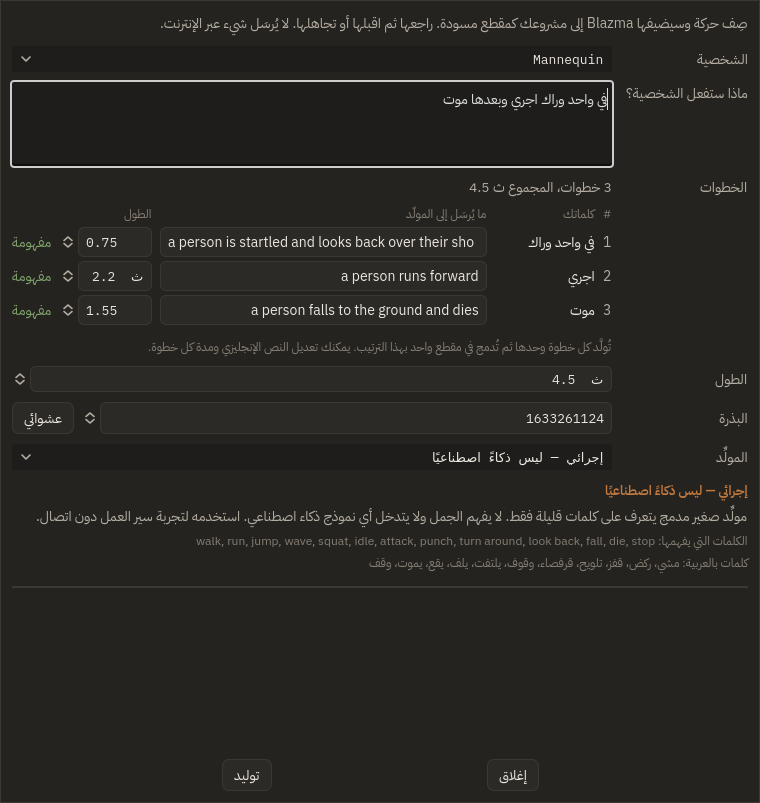

1. **الشخصية:** من سيتحرك.
2. **ماذا ستفعل الشخصية؟** وصفك بـ**العربية أو الإنجليزية** (ويفهم اللهجات الخليجية والمصرية والسودانية).
3. **الطول:** المدة الكلية بالثواني. **البذرة:** نفس البذرة مع نفس الوصف تعطي النتيجة نفسها، و**عشوائي** يختار بذرة جديدة.
4. **المولِّد:** اختر **Kimodo** (نموذج الذكاء الاصطناعي). خيار *إجرائي — ليس ذكاءً اصطناعيًا* مولّد صغير مدمج يعرف كلمات قليلة فقط، وهو لتجربة سير العمل دون اتصال.

ثم اضغط **توليد**. يظهر التقدم في النافذة ويمكنك الإلغاء في أي وقت.

### الأوصاف متعددة الخطوات

Kimodo يولّد حركة واحدة لكل وصف، ويفهم الإنجليزية أفضل. لذلك **يخطّط** Blazma نصك أولًا: يقسمه إلى **خطوات** مرتبة، ويترجم كل خطوة إلى وصف إنجليزي سليم، ويوزّع الزمن بينها. تراها وأنت تكتب:

| العمود | معناه |
|---|---|
| **كلماتك** | الجزء من نصك الخاص بهذه الخطوة |
| **ما يُرسَل إلى المولّد** | الوصف الإنجليزي الذي سيستلمه Kimodo. **قابل للتعديل** |
| **الطول** | ثواني هذه الخطوة. **قابل للتعديل** |
| الحالة | *مفهومة* أو *غير مفهومة* (أعد صياغتها) أو *معدّلة* |

مثال: **«في واحد وراك، اجري، وبعدها موت»** يصبح ثلاث خطوات: *a person is startled and looks back over their shoulder* ثم *a person runs forward* ثم *a person falls to the ground and dies*. تُولَّد كل خطوة وحدها ثم تُدمج في **مقطع مسودة واحد** فيه علامة عند بداية كل خطوة.

للفصل بين الخطوات استعمل كلمات مثل: ثم، بعدها، وبعدين، بعد ذلك، أخيرًا (وبالإنجليزية then, after that, finally)، أو الفواصل والنقاط. كلمة «بينما» و«وهو» **لا** تقسم الجملة (حركتان معًا)، والفعلان من العائلة نفسها مثل «يقع ويموت» يبقيان خطوة واحدة.

أمثلة جيدة:

- `يقفز ثم يجري للأمام ثم يقف`
- `يضرب لكمة قوية ثم يرجع لوضع الاستعداد`
- `شخص يمشي ثم يلتفت ويلوح بيده`
- `يمشي ببطء لمدة 4 ثواني ثم يجري` (تُحترم المدة مثل «لمدة 3 ثواني» أو "for 3 seconds")
- `a person jumps, then lands and crouches`

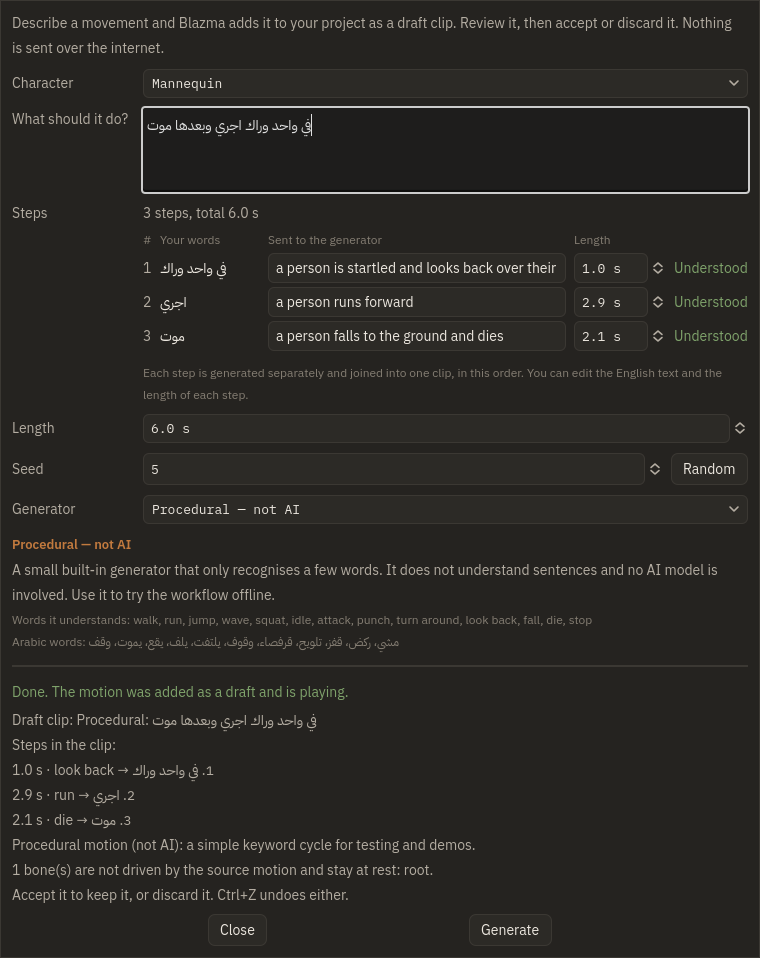

*(اللقطة بالمولّد الإجرائي الذي ينتهي فورًا، وبالواجهة الإنجليزية. Kimodo يعمل بالطريقة نفسها لكنه يستغرق وقتًا أطول.)*

### المسودات: قبول أو تجاهل

تصل النتيجة **مسودة** (تظهر كلمة «مسودة» في شريط التشغيل) وتبدأ بالعمل فورًا. لا شيء دائم بعد:

- **قبول** يُبقيها مقطعًا عاديًا.
- **تجاهل** يحذفها.
- **Ctrl+Z** يتراجع عن أي من الاختيارين.

المسودة متعددة الخطوات فيها **علامة لكل خطوة** على الخط الزمني. والمقطع المقبول مفاتيح عادية، فيمكنك تعديل مفاتيحه وتثبيت قدميه وإعادة توجيهه وتصديره كأي مقطع آخر.

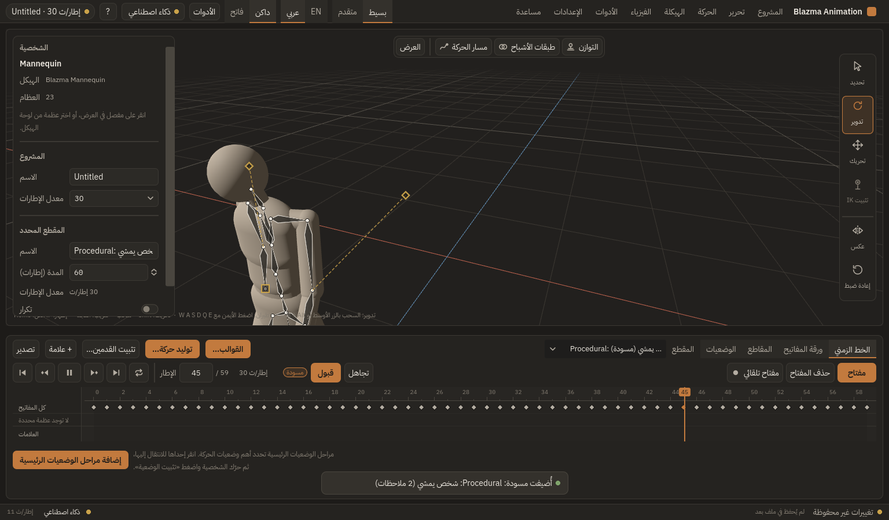

تسجيلات حقيقية للتوليد بـKimodo على المعالج (بالواجهة العربية):
[العرض 1](videos/demo-1.mp4) · [العرض 2: «في واحد وراك، اجري، وبعدها موت»](videos/demo-2.mp4) · [العرض 3](videos/demo-3.mp4) · [العرض 4](videos/demo-4.mp4)

[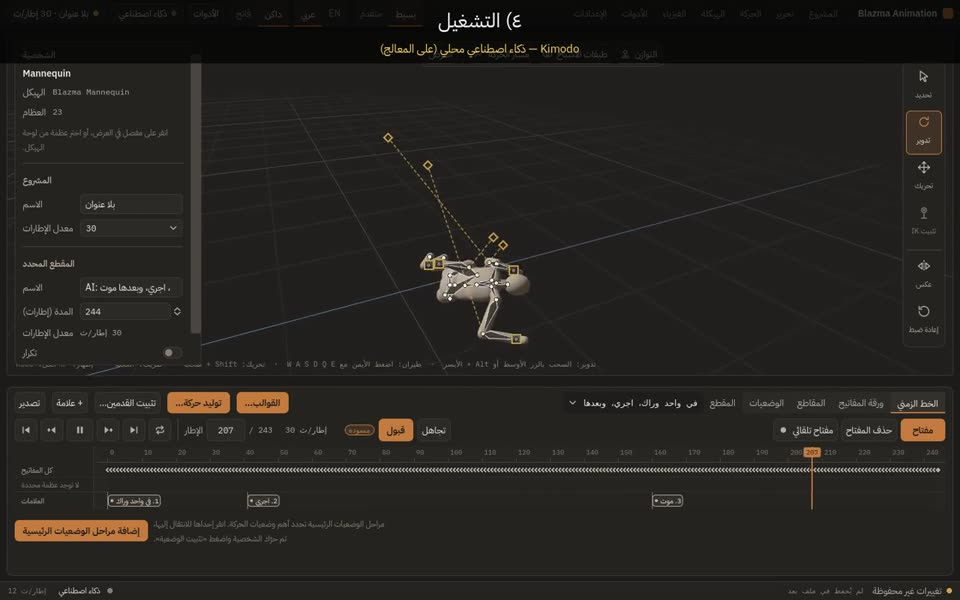](videos/demo-2.mp4)

### نصائح لأوصاف جيدة

- اكتب **فعلًا واضحًا واحدًا في كل خطوة** مع العضو والاتجاه: «a person punches forward with the right hand».
- ابدأ ببساطة ثم حسّن. استعمل **عشوائي** للبذرة لتحصل على تنويعات من الوصف نفسه.
- عدّل **النص الإنجليزي** في الخطة لتصحيح خطوة خرجت خاطئة.
- الإنجليزية الأفضل بصيغة المضارع والغائب: «a person jumps over an obstacle».
- اجعل المدد واقعية: القفزة نحو ثانية إلى ثانية ونصف، واللكمة نحو ثانية.
- التوليد على المعالج بطيء (عدة دقائق أمر عادي)، وبطاقة الرسوميات أسرع بكثير.
- الحركة المولَّدة مسودة **لتُصقَل**: بعد القبول استعمل **تثبيت القدمين…** أو الرسم البياني أو المفاتيح لتنظيفها.

---

## 8. الفيزياء: التوازن والحركة الثانوية

### طبقة التوازن

اضغط **التوازن** في الشريط فوق المسرح. يحسب Blazma **مركز كتلة** الشخصية و**منطقة الارتكاز** تحت القدمين و**هامشًا** بإشارة (الموجب يعني داخل المنطقة أي متوازن). يعرض العرض ثلاثي الأبعاد ذلك مباشرة، ويعرض **شريط التوازن** الملوّن تحت الخط الزمني كل إطار: الأخضر متوازن والأحمر غير متوازن والأصفر على الحد. تلخّص لوحة **الفيزياء** المقطع (عدد الإطارات المتوازنة وغير المتوازنة وفي الهواء، والنطاقات التي تحتاج انتباهًا).

قبل الموازنة التلقائية وبعدها (وضعية منحنية ومركز الكتلة خارج القدمين):

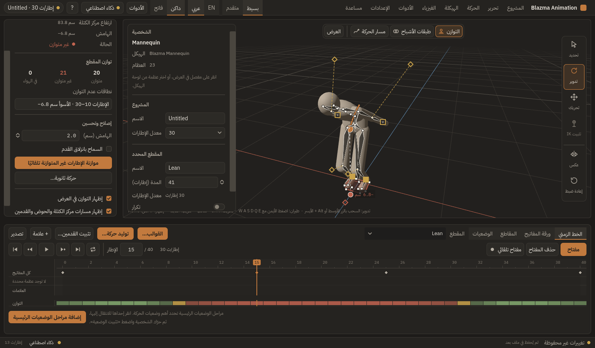 

### الموازنة التلقائية

**الفيزياء ← موازنة الإطارات غير المتوازنة تلقائيًا** تزيح الحوض أفقيًا بأقل قدر لازم مع إبقاء القدمين في مكانهما تمامًا. الإطارات المتوازنة أصلًا لا تُمس. وإن تعذّر تصحيح إطار دون انزلاق قدم فإنها ترفض بدل أن تكسر الوضعية. هي خطوة واحدة في السجل: **Ctrl+Z** يعيد الأصل. في المقطع التجريبي ارتفعت الإطارات المتوازنة من 20 من 41 إلى 41 من 41.

### الحركة الثانوية

**الفيزياء ← الحركة الثانوية…** تضيف المتابعة والتداخل، كخصلة شعر أو عباءة أو ذراع تتأخر عن الجسم. تستعمل نابضًا مخمّدًا لكل عظمة، مستقلًا عن معدل الإطارات، مع حد لمدى التأخر. اختر **الإعداد المسبق** (أي العظام تتبع: العمود الفقري والرأس، أو الرأس والرقبة فقط، أو الذراعين)، وضبط **الصلابة** (الأعلى أسرع استجابة) و**التخميد** (الأعلى يستقر أسرع) وأقصى زاوية تأخر، ثم **تطبيق**. تُكتب النتيجة مفاتيح دوران عادية فيمكنك تعديلها.

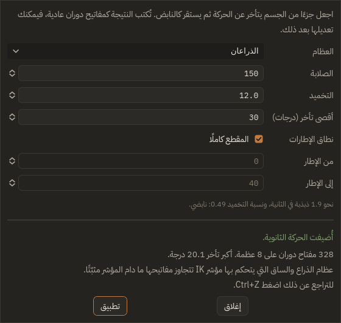

أدوات الفيزياء تفترض أرضًا مستوية، وتُحسب القدمان فقط كنقاط ارتكاز.

---

## 9. استيراد الشخصيات وإعادة التوجيه

### استيراد شخصية

**الهيكلة ← استيراد شخصية…** واختر ملف `.glb` (glTF ثنائي) فيه هيكل بشري. يقرأ Blazma الهيكل و**يطابق عظامه تلقائيًا** مع الأسماء البشرية القياسية (الحوض، العمود الفقري، الفخذ، الساق، العضد وغيرها). ويعرض تقريرًا بما تطابق وما لم يتطابق.

إن لم تتطابق بعض العظام أو تطابقت خطأً فافتح **الهيكلة ← مطابقة العظام…** وعيّنها يدويًا: اختر عظمة النموذج في جهة والعظمة القياسية في الجهة الأخرى. تُنشأ أهداف IK وحدود المفاصل من هذه المطابقة. العظام غير المطابقة (الأصابع والوجه والإضافية) تبقى في وضع الراحة.

ملاحظات: المدعوم ملفات `.glb` بالبيانات المضمّنة فقط (لا `.gltf` مع ملفات بيانات منفصلة). والتصدير للشخصية المستوردة يحتفظ بنموذجك الأصلي (الشبكة والجلد والمواد) ويضيف إليه حركتك.

### إعادة توجيه مقطع إلى شخصية أخرى

الحركات المصنوعة على المجسّم يمكن نسخها إلى شخصية مستوردة بنسب مختلفة.

1. اضغط **إعادة توجيه…** (الوضع المتقدم، تحت الخط الزمني).
2. اختر **المقطع المراد نسخه** والشخصية التي يعمل عليها الآن و**الشخصية المنسوخ إليها**.
3. أبقِ **تثبيت القدمين على الأرض** مفعّلًا لمنع الانزلاق.
4. اضغط **إعادة التوجيه**. يُضاف مقطع جديد ويبقى الأصل دون تغيير.

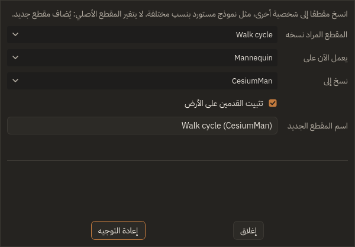

تحتفظ كل عظمة بالاتجاه نفسه الذي في المصدر حتى لو اختلفت وضعيات الراحة (T مقابل A)، وتُضرب إزاحة الجذر في نسبة طول الساق. وإعادة التوجيه تعمل للهياكل البشرية المطابَقة.

---

## 10. تثبيت القدمين

انزلاق القدمين على الأرض أشهر عيوب المشي والركض. **تثبيت القدمين…** يجد الإطارات التي تلامس فيها كل قدم الأرض ويثبّتها في نقطة واحدة هناك. أما الإطارات البعيدة عن التلامس فتبقى كما هي تمامًا.

1. حدد المقطع واضغط **تثبيت القدمين…**.
2. راجع التلامسات المكتشفة. يعرضها شريط تحت الخط الزمني (**إظهار ملامسة القدمين** يبدّله).
3. طبّق. **Ctrl+Z** يتراجع.

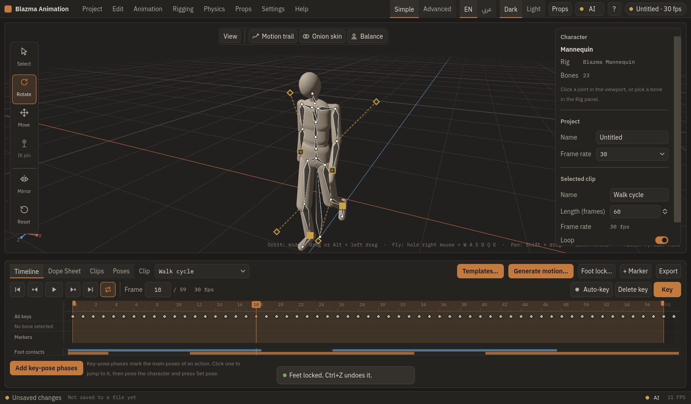

يفترض التثبيت أرضًا مستوية، وأفضل نتائجه مع المشي والركض والوقوف.

---

## 11. التسلسلات والدمج

اربط عدة مقاطع في حركة طويلة واحدة بانتقالات ناعمة. افتح تبويب **التسلسل** (الوضع المتقدم).

1. أنشئ تسلسلًا (**جديد…**) وأضف مقاطع بـ**إضافة مقطع**. كل مقطع شريط على مسار تستطيع سحبه.
2. اجعل شريطين يتداخلان ليمتزجا. مقبض الدمج يحدد مدة الانتقال، والمنحنى (مثل *ناعم*) شكله.
3. **المتابعة من المقطع السابق** تُكمل تقدم الشخصية من حيث انتهى المقطع السابق، و**إبقاء الاتجاه** يحفظ الوجهة. **مطابقة طور القدمين** تضبط الخطوة عند الانتقال من مشي إلى ركض فلا تحدث قفزة. و**تثبيت القدمين** يطبّق التثبيت على الناتج.
4. **تشغيل** يعاينه في العرض ثلاثي الأبعاد. **تحويل إلى مقطع** يحوّل التسلسل إلى مقطع عادي، و**تصدير…** يكتبه مباشرة في `.glb`.

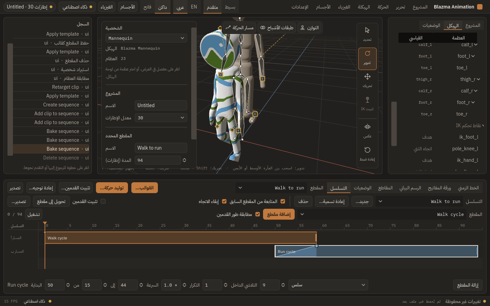

والآلية نفسها هي ما يضم خطوات الوصف متعدد الخطوات.

---

## 12. الأدوات (Props)

الأداة (Prop) جسم مثل سيف أو درع أو صندوق يتحرك مع الحركة. (في القوائم العربية تظهر باسم «الأدوات».)

1. افتح لوحة **الأدوات** (زر **الأدوات** في الشريط العلوي أو قائمة الأدوات).
2. أضف **صندوقًا** أو **كرة** أو **أسطوانة** بالحجم الذي تريد (السيف أسطوانة رفيعة 0.05 × 0.9 × 0.05 م)، أو **استيراد .glb…** لنموذج حقيقي.
3. **اربطها** بعظمة: اختر العظمة (مثل `hand_r`) أو حدد عظمة واضغط **استخدام العظمة المحددة**. صارت الأداة تتبع اليد.
4. حرّك الأداة وأدرها بالأدوات لتضبط طريقة إمساكها، واستعمل **مفتاح للأداة** لتحريكها (كرميها أو إغمادها).
5. تُصدَّر الأدوات داخل `.glb` تحت العظمة المربوطة بها، وتُذكر في الملف المرافق.

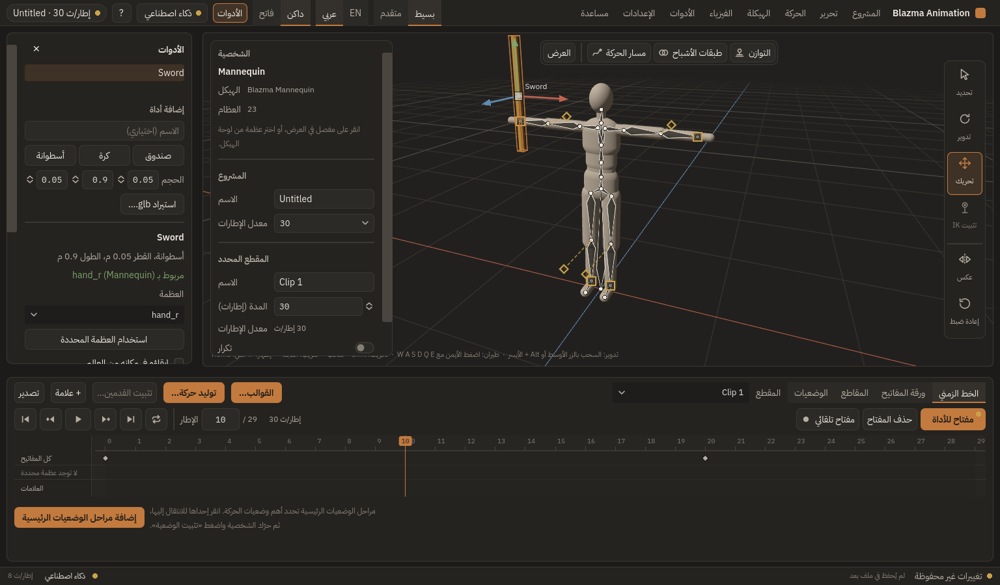

احذف الأداة بمفتاح **Delete** أو «حذف الأداة». ليس للأدوات فيزياء ولا تصادم.

---

## 13. أدوات القتال

لألعاب القتال والأكشن. افتح قائمة **القتال** أو لوحة **القتال** (الوضع المتقدم). اللوحة تخص **مقطعًا واحدًا وشخصية واحدة**.

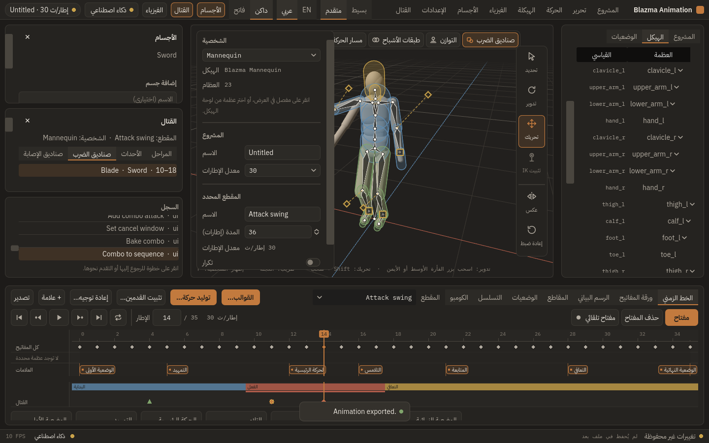

### المراحل

لكل هجمة ثلاث مراحل: **البداية** (الاستعداد) و**الفعل** (الجزء الذي قد يصيب) و**التعافي**. اضبطها يدويًا أو دع Blazma يقرأها من علامات الوضعيات الرئيسية. تظهر أشرطة ملونة في **شريط القتال** تحت الخط الزمني.

### صناديق الضرب وصناديق الإصابة

- **صناديق الضرب (Hitboxes)** أشكال تُحدث الضرر: كرة أو كبسولة أو صندوق مربوط بعظمة أو أداة (مثل نصل السيف). تحدد **الإطارات الفعّالة** و**الضرر** و**الدفع** و**توقف الضرب (hit-stop)**.
- **صناديق الإصابة (Hurtboxes)** أشكال يمكن أن تُصاب. **توليد صناديق الإصابة** ينشئ مجموعة تغطي الجسم البشري (نحو 20 كبسولة) ثم تعدّلها كما تشاء.

اضغط مفتاح **صناديق الضرب** فوق المسرح لرؤيتها. تُلوَّن صناديق الإصابة بحسب منطقة الجسم، وتضيء صناديق الضرب في إطاراتها الفعّالة.

### الأحداث

**إضافة حدث عند المؤشر…** تضيف علامة مصنّفة (ضربة أو خطوة أو صوت أو مؤثر بصري أو مخصص) بحمولة صغيرة. تقرؤها شيفرة اللعبة من التصدير.

### اختبار الضرب

**اختبار الضرب…** يحرّك الهجمة نحو شخصية ثانية ويخبرك هل تصيب ومتى وأين.

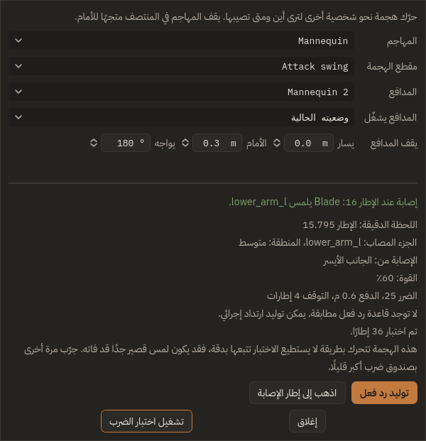

حدد مقطع المهاجم والمدافع ومكان وقوف المدافع واتجاهه. تعرض النتيجة أول **إطار إصابة** (باللحظة الدقيقة) والعضو والمنطقة والجهة القادمة منها والقوة والضرر والدفع وتوقف الضرب. وإن كانت الهجمة سريعة جدًا يحذّر من احتمال فوات لمسة قصيرة جدًا ويقترح صندوق ضرب أكبر قليلًا. **اذهب إلى إطار الإصابة** ينقلك إليه.

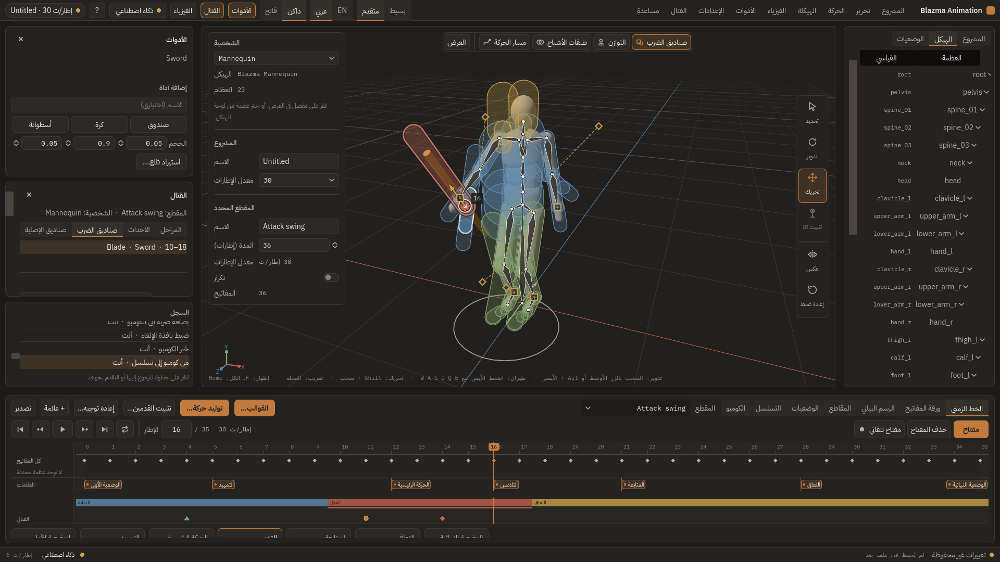

### ردود الفعل

**توليد رد فعل** ينشئ ارتدادًا للمدافع ينحني بعيدًا عن جهة الضربة ويعود إلى الوضعية الأساسية. ويمكنك تعريف قواعد بحسب الاتجاه والارتفاع والقوة. ردود الفعل الإجرائية تؤثر في الجذع والرأس.

### الكومبو

تبويب **الكومبو** (المتقدم) يربط مقاطع الهجوم في كومبو واحد: **إضافة هجمة** مع مفتاح **إدخال** (مثل X أو Y)، ثم حدّد **نافذة إلغاء** (الإطارات التي يجوز فيها للهجمة التالية أن تقاطع الحالية). **تحويل إلى مقطع** أو **دمج في تسلسل** ينتج الحركة النهائية مع قطع الهجمات الملغاة عند نقطة الربط.

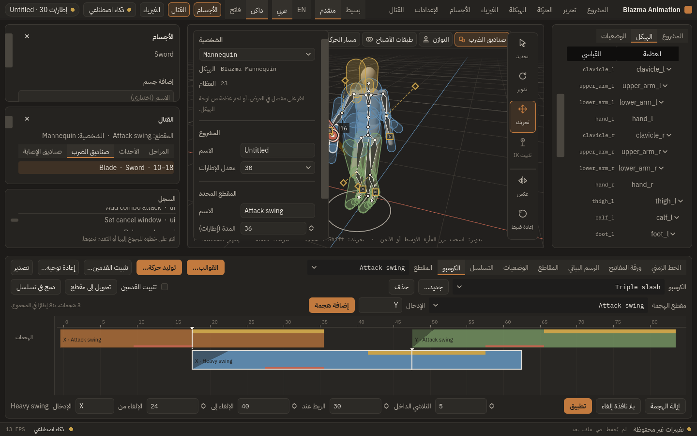

تُكتب بيانات القتال (المراحل والأحداث وصناديق الضرب والإصابة والقواعد والكومبو) في الملف المرافق ويُتحقق منها بعد التصدير.

---

## 14. التصدير إلى محركات الألعاب

اضغط **تصدير** (أو **Ctrl+E**، أو المشروع ← تصدير الحركة…).

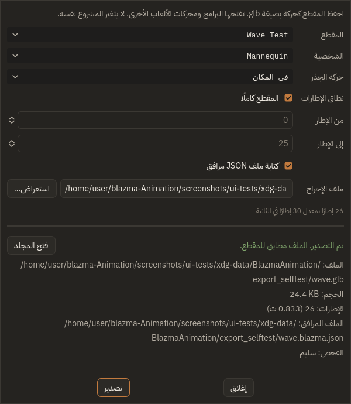

| الخيار | المعنى |
|---|---|
| **المقطع / الشخصية** | ما سيُصدَّر |
| **حركة الجذر** | **إبقاء** (كما صُنعت)، أو **في المكان** (تحذف الانتقال الأفقي وتُبقي الارتفاع، لمحركات تحرّك الشخصية بنفسها)، أو **في المكان كليًا** (تحذف كل الإزاحة) |
| **نطاق الإطارات** | المقطع كاملًا أو نطاق محدد |
| **كتابة ملف JSON مرافق** | يكتب أيضًا `<name>.blazma.json` بجانب الملف |
| **ملف الإخراج** | مكان الحفظ (زر **استعراض…**) |

بعد التصدير **يعيد Blazma فتح الملف ويتحقق منه** مقابل المقطع. تعرض النافذة «الفحص: سليم» والحجم وعدد الإطارات وزر **فتح المجلد**. وإن كان الملف موجودًا يسألك قبل الاستبدال.

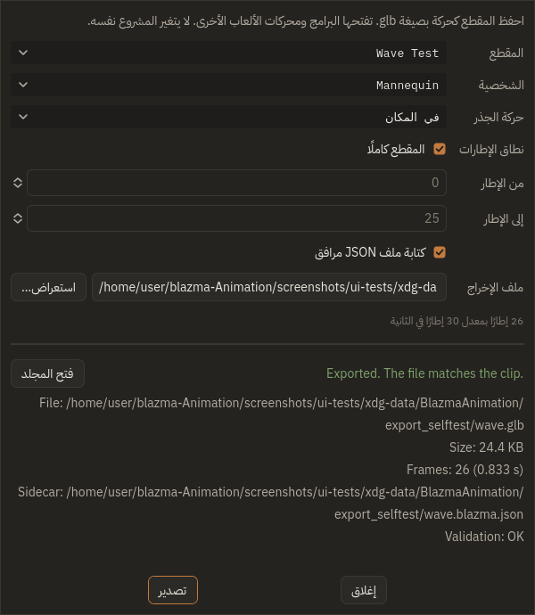

### ماذا تحصل عليه

- **`<name>.glb`** — glTF 2.0 ثنائي. الحركة مخبوزة إطارًا إطارًا (مع حل IK) بقنوات خطية. المجسّم المدمج يُصدَّر كهيكل مفصلي بسيط (بلا Skin). والشخصية المستوردة تحتفظ بشبكتها وجلدها ومواردها وتستقبل حركتك مقطعًا إضافيًا. وتُضمَّن الأدوات (Props).
- **`<name>.blazma.json`** (الملف المرافق) — معلومات لا يتسع لها glTF:
  - اسم المقطع ومعدل الإطارات وأول إطار وآخره والمدة؛
  - نطاق **التكرار**؛
  - **العلامات** (بما فيها أسماء المراحل)؛
  - **الأحداث** وحمولاتها (خطوة، ضربة، صوت...)؛
  - **حركة الجذر**: الوضع والإزاحة المحذوفة وفروق كل إطار وإزاحة دورة تكرار واحدة، ليحرّك محركك الشخصية المسافة الصحيحة؛
  - **قائمة العظام** بأسمائها القياسية وآبائها؛
  - **بيانات القتال**: المراحل وصناديق الضرب والإصابة وقواعد ردود الفعل والكومبو؛
  - **الأدوات** وما ترتبط به.

### في Godot وغيره من المحركات

استورد `.glb` كالمعتاد. يعرض Godot المقطع كحركة ضمن المشهد المستورد؛ واقرأ الملف المرافق في شيفرتك لربط الخطوات وأحداث الضرب وحركة الجذر. يحذف Godot القنوات الثابتة عند الاستيراد، والبيانات كاملة في الملف. ويستطيع Unity وUnreal استيراد glTF عبر مستورداتهما. تصدير FBX غير متاح.

---

## 15. الحفظ والحفظ التلقائي والاستعادة

- **Ctrl+S** للحفظ، **Ctrl+Shift+S** للحفظ باسم، **Ctrl+O** للفتح، **Ctrl+N** لمشروع جديد. المشروع ملف `.blazanim` واحد يحوي كل شيء: الشخصيات والمقاطع والوضعيات والأدوات وبيانات القتال وأي نموذج مستورد.
- الحفظ آمن: يُكتب الملف ويُتحقق منه ثم يُستبدل، وتبقى النسخة السابقة بجانبه كاحتياط.
- **الحفظ التلقائي:** اختر وتيرته من قائمة **الإعدادات** (إيقاف، كل دقيقة، 3، 5، أو 10 دقائق). يعمل في الخلفية دون أن يقاطعك.
- **الاستعادة:** إن أُغلق البرنامج فجأة، يعرض لك التشغيل التالي **استعادة العمل غير المحفوظ**. اختر النسخة التي تريدها.
- لا يمكن فتح المشروع نفسه في مكانين في وقت واحد (البرنامج وأداة خارجية مثلًا)، وتظهر رسالة «المشروع مقفل».
- **الوضع المحمول:** مع وجود `portable.txt` بجانب البرنامج تُحفظ الإعدادات والحفظ التلقائي والسجلات في `userdata` بجانبه.

أماكن التخزين:

| ما هو | بعد التثبيت | المحمولة |
|---|---|---|
| الإعدادات والحفظ التلقائي | `%APPDATA%\BlazmaAnimation` | `userdata\` |
| ملفات نماذج الذكاء الاصطناعي | `%LOCALAPPDATA%\BlazmaAnimation\models` | `userdata\models` |
| على Linux | `$XDG_DATA_HOME/BlazmaAnimation` (عادةً `~/.local/share/BlazmaAnimation`) | |

---

## 16. ربط أدوات الذكاء الاصطناعي الخارجية (MCP / CLI)

يضم Blazma أدوات تتيح لمساعد ذكاء اصطناعي خارجي، مثل **Claude Code** أو **Codex**، أن يقود البرنامج نيابةً عنك. هذه الميزة اختيارية.

- `tools\blazma-mcp.exe` — **خادم MCP** تتصل به البرامج التي تدعم MCP.
- `tools\blazma-anim.exe` — أداة **سطر أوامر** للوكلاء الذين يشغّلون أوامر الطرفية.

الخلاصة لـClaude Code:

```
claude mcp add blazma -- "C:\Blazma\tools\blazma-mcp.exe"
```

افتح لوحة **الذكاء الاصطناعي** في Blazma وتأكد أن **السماح للوكلاء** مفعّل. اختر **مساعد** (تنتظر كل مهمة **اعتمادك** أو **رفضك**) أو **مستقل**. لا يستطيع الوكلاء تشغيل أوامر النظام ولا قراءة ملفات عشوائية، والحذف يحتاج موافقتك دائمًا.

الدليل الكامل خطوة بخطوة: [AGENT_SETUP_AR.md](AGENT_SETUP_AR.md). والمراجع: [MCP_TOOLS.md](MCP_TOOLS.md) و[CLI_REFERENCE.md](CLI_REFERENCE.md) و[AI_GUIDE.md](AI_GUIDE.md).

---

## 17. حل المشكلات والأسئلة الشائعة

**يظهر «Windows protected your PC» (SmartScreen).**
البرنامج غير موقَّع بعد. اضغط **More info** ثم **Run anyway**. وتحقق من الملف بمقارنة بصمته مع `SHA256SUMS.txt`.

**تظهر «MSVCP140.dll was not found» عند توليد الحركة.**
ثبّت Microsoft Visual C++ 2015–2022 x64 Runtime من <https://aka.ms/vs/17/release/vc_redist.x64.exe>. المثبّت يفعل ذلك لك، أما النسخة المحمولة فلا.

**البرنامج لا يرى بطاقة الرسوميات.**
افتح **الإعدادات ← نماذج الذكاء الاصطناعي…** واضغط **تحديث**، أو اضغط **فحص** في **توليد الحركة (ذكاء اصطناعي)…**. حدّث تعريف البطاقة (تعريفات NVIDIA توفّر CUDA، وأي تعريف حديث يوفّر Vulkan). اجعل الجهاز **تلقائي**؛ فإن فشلت محاولة على البطاقة ينتقل Blazma إلى بديل ويخبرك. وللأمان يمكنك دائمًا اختيار **المعالج فقط**. التوليد على البطاقة ميزة حديثة (v0.11) ما زالت تُختبر على أجهزة أكثر، وملاحظاتك مرحَّب بها.

**التوليد بطيء جدًا.**
على المعالج قد يستغرق التوليد الواحد عدة دقائق. استعمل بطاقة الرسوميات إن توفرت (تلقائي أو **بطاقة الرسوميات + المعالج**)، واختر الحزمة **الخفيفة** على الأجهزة الضعيفة، وولّد مقطعًا أقصر، وأغلق البرامج الثقيلة الأخرى لأن النماذج تحتاج ذاكرة كبيرة. الحد الزمني للتوليد الواحد قابل للضبط في إعدادات الذكاء الاصطناعي (الافتراضي 15 دقيقة).

**توقف تنزيل النموذج أو انقطع الاتصال.**
اضغط **تنزيل** مرة أخرى: يستأنف من الملف الجزئي (`.part`) ويتحقق من البصمة في النهاية. وإن فشل ملف في التحقق يُحذف ويُنزَّل من جديد.

**أين نماذجي وإعداداتي؟**
انظر جدول القسم 15. يمكنك حذف مجلد النماذج لتحرير مساحة، وستعرض نافذة النماذج تنزيله من جديد.

**وصفي بالعربية «غير مفهوم».**
أضف فعلًا واضحًا (يجري، يمشي، يقفز، يقع، يموت، يلتفت، يلوح، يضرب...) أو اكتب هذه الخطوة بالإنجليزية في عمود **ما يُرسَل إلى المولّد**.

**الحركة المولَّدة تبدو خاطئة.**
جرّب بذرة أخرى، أو بسّط الوصف إلى فعل واحد، أو عدّل النص الإنجليزي، أو ولّد كل خطوة على حدة. ثم نظّف النتيجة بالمفاتيح وتثبيت القدمين.

**قدما المجسّم تنزلقان.**
استعمل **تثبيت القدمين…** (القسم 10) أو ثبّت القدمين بـIK (القسم 4).

**الشخصية المستوردة ملتوية.**
راجع **الهيكلة ← مطابقة العظام…** وصحّح تعيين اليمين واليسار والذراعين والساقين.

**الحركة المصدَّرة تبتعد في المحرك.**
صدّر بخيار **حركة الجذر: في المكان** وحرّك الشخصية في المحرك باستعمال بيانات حركة الجذر في الملف المرافق.

**فتحت المشروع مرتين.**
المشروع الواحد يُفتح في مكان واحد فقط. أغلق النسخة الأخرى أو اعمل على نسخة مكررة.

**هل عملي آمن إن انهار البرنامج؟**
فعّل الحفظ التلقائي من **الإعدادات**، وعند التشغيل التالي استعمل **استعادة العمل غير المحفوظ**.

**الترخيص.**
Blazma Animation برنامج مملوك، كل الحقوق محفوظة لـmr-kateba؛ انظر [LICENSE](../LICENSE). المكوّنات الخارجية المضمّنة تحتفظ بتراخيصها (انظر `THIRD_PARTY_NOTICES.md`).

---

## 18. مرجع لوحة المفاتيح والفأرة

### الفأرة في العرض ثلاثي الأبعاد

| الإدخال | الإجراء |
|---|---|
| الزر الأيمن (باستمرار) | الطيران (النظر حولك) |
| سحب الزر الأوسط، أو Alt + سحب الأيسر | التدوير |
| Shift + سحب | تحريك جانبي (Pan) |
| العجلة | تقريب وتبعيد (وتغيّر سرعة الطيران أثناء الطيران) |
| النقر بالزر الأيسر | تحديد مفصل أو أداة |

### لوحة المفاتيح

اضغط **F1** (أو **?**) في أي وقت لعرض ورقة الاختصارات: كل اختصار حسب الفئة، مع بحث وزر **طباعة…** لنسخة من صفحة واحدة. لا تعمل الاختصارات أثناء الكتابة في حقل نصي. كل ما يلي قابل للتغيير من **الإعدادات ← اختصارات لوحة المفاتيح…** (انظر «تخصيص الاختصارات» بعد الجداول).

بعض المفاتيح يختلف معناها بحسب مكان التركيز: **Home** يُظهر كل شيء عندما يكون التركيز على العرض ثلاثي الأبعاد، وينتقل إلى الإطار الأول في أي مكان آخر. أما **F** ومفاتيح لوحة الأرقام للمناظر فتعمل في العرض ثلاثي الأبعاد فقط.

| الفئة | المفاتيح | الإجراء |
|---|---|---|
| **ملف** | Ctrl+N / Ctrl+O | جديد / فتح |
| | Ctrl+S / Ctrl+Shift+S | حفظ / حفظ باسم |
| | Ctrl+E | تصدير الحركة |
| | Ctrl+Q | خروج |
| **تحرير** | Ctrl+Z / Ctrl+Shift+Z (أو Ctrl+Y) | تراجع / إعادة |
| | Delete | حذف الأداة أو المقطع المحدد (بعد تأكيد) |
| | Ctrl+D | تكرار المقطع |
| | A أو Ctrl+A | تحديد كل المفاتيح (ورقة المفاتيح) |
| **التشغيل** | Space | تشغيل أو إيقاف مؤقت |
| | اليسار / اليمين | الإطار السابق / التالي |
| | Shift+يسار / Shift+يمين | قفز 10 إطارات |
| | الأسفل / الأعلى (أو Alt+يسار / Alt+يمين) | المفتاح السابق / التالي |
| | Home / End | الإطار الأول / الأخير (Home يُظهر كل شيء إذا كان التركيز على العرض ثلاثي الأبعاد) |
| | L | تفعيل التكرار أو إيقافه |
| **المفاتيح** | I أو K | مفتاح للوضعية كاملة |
| | Shift+K أو Shift+I | مفتاح للعظمة أو نقطة التحكم المحددة فقط |
| | Alt+I أو Alt+K | حذف المفاتيح عند هذا الإطار |
| | Ctrl+K | تفعيل التسجيل التلقائي أو إيقافه |
| **الأدوات** | Q / W / E | تحديد / تحريك (نقطة IK أو الحوض) / تدوير |
| | M | عكس الوضعية |
| | Shift+P | تثبيت اليد أو القدم المحددة أو إلغاء تثبيتها |
| **التحريك** | Alt+R | إعادة العظمة المحددة إلى وضعها الأصلي |
| | Alt+G | إعادة الوضعية كاملة إلى الأصل (بعد تأكيد) |
| | Ctrl+C / Ctrl+V | نسخ ولصق وضعية (أو مفاتيح في ورقة المفاتيح) |
| | Ctrl+Shift+V | لصق الوضعية معكوسة |
| **العرض** | F أو . في لوحة الأرقام | إظهار المحدد (العرض ثلاثي الأبعاد) |
| | Home | إظهار كل شيء (العرض ثلاثي الأبعاد) |
| | 1 / 3 / 7 في لوحة الأرقام | عرض أمامي / جانبي / علوي |
| | 5 في لوحة الأرقام | منظور / متعامد |
| | T | إظهار اللوحات الجانبية أو إخفاؤها |
| | N | إظهار المفتش أو إخفاؤه |
| | ` (علامة الإمالة الخلفية) أو Tab | التبديل بين البسيط والمتقدم |
| | F11 | ملء الشاشة |
| | B | طبقة التوازن |
| | P | مسارات الحركة (أثر الحركة) |
| | O | قشرة البصل |
| **الذكاء الاصطناعي** | Ctrl+G | توليد حركة… |
| | Ctrl+T | القوالب… |
| **مساعدة** | F1 أو ? | ورقة الاختصارات |
| | Shift+F1 | الشرح التعليمي |
| **الطيران** (والزر الأيمن مضغوط) | W A S D / Q E | للأمام واليسار والخلف واليمين / للأسفل والأعلى |
| | Shift / Ctrl | أسرع / أبطأ |

> لا توجد أداة تكبير: يُحرَّك المجسّم والهياكل المستوردة بالتدوير وحركات IK والحوض، لا بتكبير العظام.

### تخصيص الاختصارات

افتح **الإعدادات ← اختصارات لوحة المفاتيح…** (أو **مساعدة ← تخصيص الاختصارات…**).

- **ابحث** باسم الإجراء أو فئته أو مفتاحه.
- **انقر** المفتاح ثم اضغط الاختصار الجديد. **Esc** يلغي. **×** يزيل الاختصار و**↺** يعيد الافتراضي.
- إذا كان المفتاح مستخدمًا في إجراء آخر في المكان نفسه فيظهر **تنبيه** يسمّيه ويسأل: **استبدال** (يبقى ذلك الإجراء بلا مفتاح) أو **إلغاء**. يمكن أن يشترك إجراءان في المفتاح نفسه فقط إذا كانا يعملان في مكانين مختلفين (مثل Home في العرض ثلاثي الأبعاد وعلى الخط الزمني).
- **إعادة الكل إلى الافتراضي** و**تصدير…** و**استيراد…** (ملف JSON صغير) تتيح لك نسخ مفاتيحك احتياطيًا أو نقلها بين الأجهزة.
- تُحفظ اختياراتك مع إعداداتك فتتبع المجلد المحمول أيضًا. وتعرض القوائم والأزرار والتلميحات مفاتيحك الحالية.

</div>
