# Blazma Animation — User Guide (English)

[العربية](GUIDE_AR.md) · [Back to README](../README.md)

Blazma Animation is a 3D character animation studio for your desktop. You pose a character, set keys on a timeline, or simply describe a movement in words, then export a `.glb` file that Godot, Unity, Unreal (via glTF) and most 3D tools can open. This guide walks you through every part of the app, step by step. It describes version **1.0.0**.

> **Language of the app:** the interface is available in English and Arabic (right-to-left). Switch at any time with the **EN / عربي** buttons in the top bar. Every screenshot in this guide is real; Arabic versions of many of them are shown in the [Arabic guide](GUIDE_AR.md).

## Contents

1. [Install and first launch](#1-install-and-first-launch)
2. [Interface tour](#2-interface-tour)
3. [Camera controls](#3-camera-controls)
4. [Posing a character](#4-posing-a-character)
5. [Timeline and keys](#5-timeline-and-keys)
6. [Templates: ready-made motions](#6-templates-ready-made-motions)
7. [Generating motion from text](#7-generating-motion-from-text)
8. [Physics: balance and secondary motion](#8-physics-balance-and-secondary-motion)
9. [Importing characters and retargeting](#9-importing-characters-and-retargeting)
10. [Foot lock](#10-foot-lock)
11. [Sequences and blending](#11-sequences-and-blending)
12. [Props](#12-props)
13. [Combat tools](#13-combat-tools)
14. [Exporting to game engines](#14-exporting-to-game-engines)
15. [Saving, autosave and recovery](#15-saving-autosave-and-recovery)
16. [Connecting external AI tools (MCP / CLI)](#16-connecting-external-ai-tools-mcp--cli)
17. [Troubleshooting and FAQ](#17-troubleshooting-and-faq)
18. [Keyboard and mouse reference](#18-keyboard-and-mouse-reference)

---

## 1. Install and first launch

Download the latest build from the [Releases page](https://github.com/mr-kateba/blazma-Animation/releases). Windows 10 and 11 (64-bit) are the main platform. Linux x64 builds (`.tar.gz` and `AppImage`) are also published.

### Installer or portable?

| | Installer | Portable |
|---|---|---|
| File | `BlazmaAnimation-<version>-setup.exe` | `BlazmaAnimation-<version>-win64.zip` |
| Needs administrator rights | No (installs for your user) | No |
| Start menu entry, uninstaller | Yes | No |
| Associates `.blazanim` files | Yes (optional) | No |
| Where settings live | `%APPDATA%\BlazmaAnimation` | `userdata` folder next to the program |
| Best for | Your own PC | A USB drive, or trying it out |

**Installer:** run it, choose the components (the program; the `.blazanim` file association; an optional desktop shortcut) and finish. It installs to `%LOCALAPPDATA%\Programs\BlazmaAnimation`. To remove it use Settings > Apps, or `uninstall.exe` in the install folder. Your settings are kept; the uninstaller asks whether to delete downloaded AI models (default: keep them).

**Portable:** unzip anywhere and run `BlazmaAnimation.exe`. The file `portable.txt` next to the program turns on portable mode, so settings and autosave go to a `userdata` folder beside the program instead of `%APPDATA%`. Delete `portable.txt` to leave portable mode.

Neither option needs .NET or Godot to be installed.

### Windows SmartScreen

The program is not yet digitally signed, so Windows may show "Windows protected your PC". Click **More info**, then **Run anyway**. To check that your download is intact, compare it with `SHA256SUMS.txt` from the release page:

```
certutil -hashfile BlazmaAnimation-<version>-setup.exe SHA256
```

### Visual C++ runtime (needed for AI motion generation)

The motion-generation engine (`kimodo-runner.exe`) needs the *Microsoft Visual C++ 2015–2022 x64 Runtime*. The **installer** checks for it and installs it for you (Windows asks for administrator approval for that one step only). With the **portable** zip, install it once yourself from <https://aka.ms/vs/17/release/vc_redist.x64.exe>. If it is missing you will see "MSVCP140.dll was not found" when generating motion; everything else in the app still works.

### First launch

The very first time you run Blazma it looks at your computer's language and opens a **Welcome** screen. Arabic systems (any Arabic region) pre-select **العربية**, everything else pre-selects **English**; pick the language and the **Dark** or **Light** theme you prefer and press **Continue**. The choice is saved and the screen does not appear again. You can change language and theme at any time in the top bar or in **Settings**, and reopen the screen from **Settings > Welcome**.

Next Blazma offers a two-minute **interactive tutorial** ("How Blazma works"). It dims the window and lights up the real buttons one at a time with a short card for each step: the stage and camera, selecting and posing bones (FK and IK), keys on the timeline, templates, **Generate motion…** with a multi-step sentence and the plan table, drafts (accept or discard), the balance view, export and saving. One optional step lets you try it: it adds the walk template and plays it. Use **Next** / **Back**, **Skip** to jump out, or **Esc**. The **?** button in the top bar and **Help > Tutorial** (Shift+F1) open it again whenever you like.

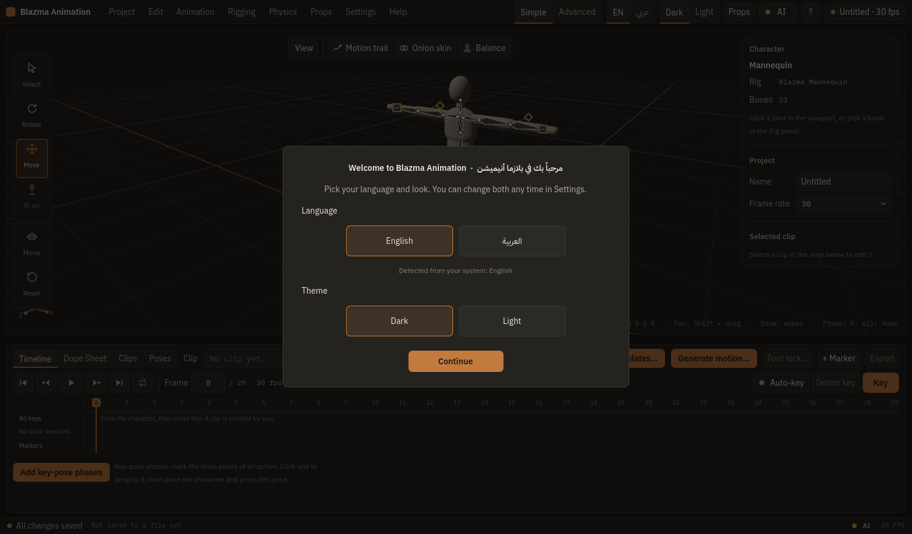

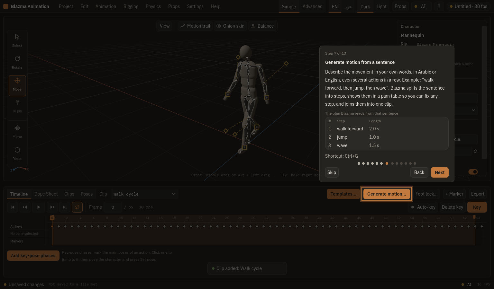

#### The first project

When the app opens you get a project with a built-in **Mannequin** character standing in a T-pose, an empty timeline, and the **Simple** interface. There is nothing to set up. Pose the mannequin and press **Key** (section 4), or press **Templates…** for an instant walk cycle (section 6).

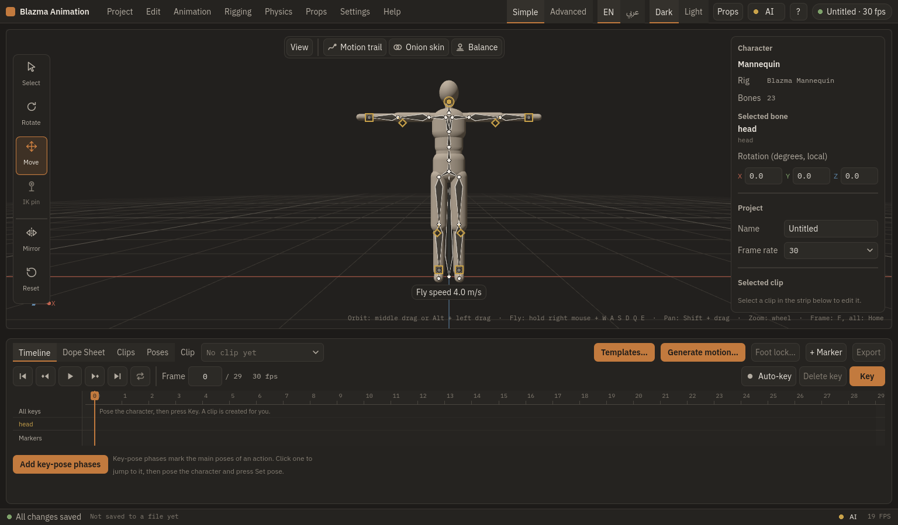

---

## 2. Interface tour

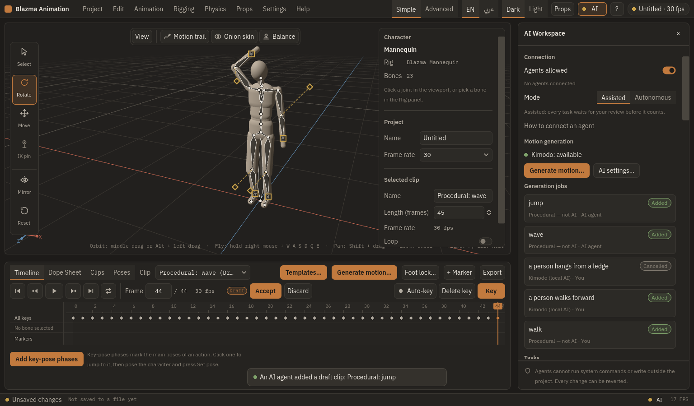

From top to bottom:

- **Menu bar** — Project, Edit, Animation, Rigging, Physics, Props, Settings (and Combat in Advanced mode).
- **Top-right controls** — the **Simple / Advanced** switch, the **EN / عربي** language switch, the **Dark / Light** theme switch, panel buttons (Props, Combat, Physics, AI) and the project name with its frame rate.
- **3D view (centre)** — the stage. The left toolbar holds the tools (Select, Rotate, Move, IK pin, Mirror, Reset). The strip above the view toggles **Motion trail**, **Onion skin**, **Balance** (and **Hitboxes** in Advanced mode), and opens the **View** menu.
- **Inspector (right of the view)** — the selected character, bone, project and clip properties.
- **Bottom dock** — tabs for **Timeline**, **Dope Sheet**, **Clips**, **Poses** (and **Graph**, **Sequence**, **Combo** in Advanced mode), with the transport controls (play, step, loop), the **Key** button and the main action buttons: **Templates…**, **Generate motion…**, **Foot lock…**, **Retarget…**, **Export**.
- **Status bar** — save state ("Unsaved changes" / "All changes saved"), the project file path, and the AI indicator.

### Simple vs Advanced

**Simple** shows only what you need to pose, key, generate and export. **Advanced** adds the project outline and **Rig** tree on the left, the **History** list on the right, extra bottom tabs (Graph, Sequence, Combo) and the Combat menu. Switching modes only hides or shows panels. Every feature works in both modes, and your work is never changed by switching.

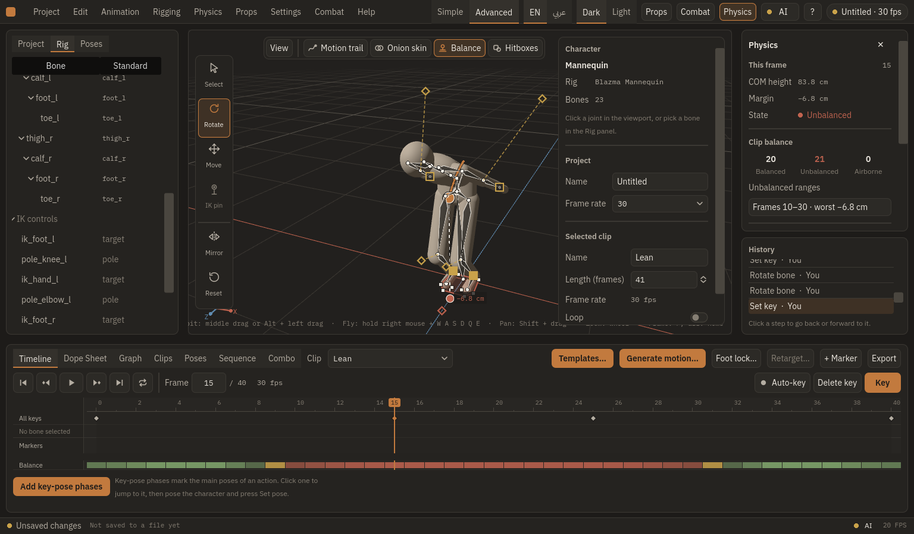

### Language and theme

Click **EN** or **عربي** in the top bar. Choosing Arabic flips the whole layout to right-to-left, including panels and timeline labels. The timeline itself always runs left to right, as in every animation tool. **Dark** and **Light** change the theme.

On a smaller screen (1280–1440 px wide, or with many panels open) the top bar makes room by itself: the app name is hidden first, then the mode, language and theme switches move into the **⋯** button (they are also in **Settings**), then the Props, Combat and Physics buttons show an icon only. When the window is still too narrow, the project outline steps aside until there is room again, and the timeline buttons wrap onto a second line.

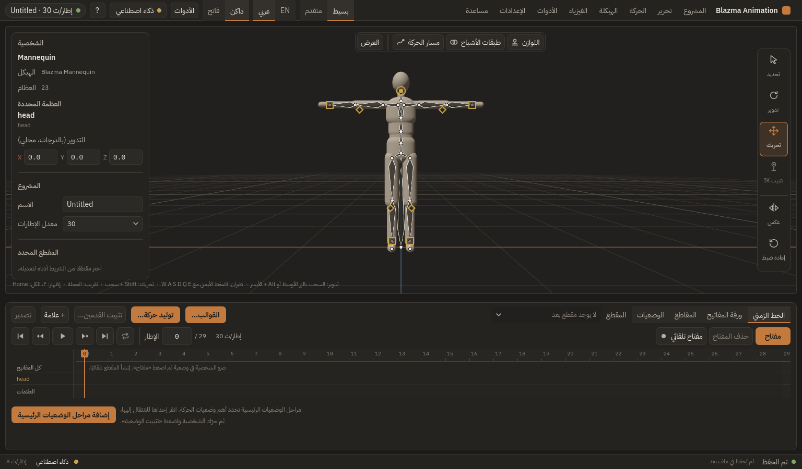

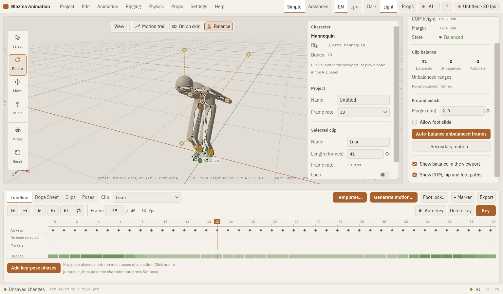

### Undo and redo

**Ctrl+Z** undoes and **Ctrl+Y** (or Ctrl+Shift+Z) redoes. In Advanced mode the **History** list shows every step; click one to jump back or forward to it.

---

## 3. Camera controls

You can fly through the scene like in a game editor, or orbit around the character.

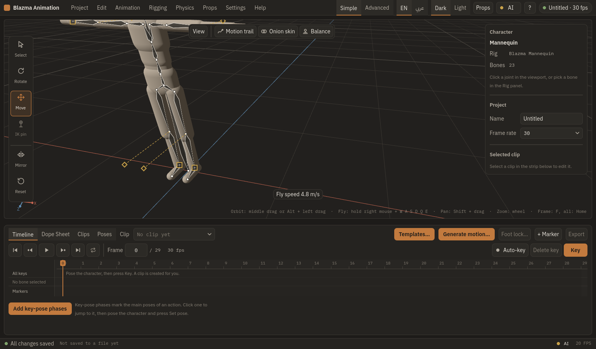

| Action | Control |
|---|---|
| **Fly** | Hold the **right mouse button**, then move the mouse to look and press **W A S D** to move |
| Down / up while flying | **Q** / **E** |
| Faster / slower while flying | Hold **Shift** (about 3x) / hold **Ctrl** (quarter speed) |
| Change fly speed | Mouse wheel while flying (a notice shows the speed, 0.5 to 40 m/s) |
| **Orbit** | Hold the **middle mouse button** and drag, or **Alt + left mouse button** and drag |
| Pan | **Shift** + drag |
| Zoom | Mouse wheel |
| Frame the selection | **F** or numpad **.** |
| Frame everything | **Home** |
| Front / side / top view | Numpad **1** / **3** / **7** (add **Ctrl** for the opposite side) |
| Perspective / orthographic | Numpad **5** |

> While the 3D view is focused, **W**, **E**, **Q** also select the Move, Rotate and Select tools. They only fly the camera while you are holding the right mouse button.

### The View menu

The **View** button in the strip above the stage lists the same commands with their shortcuts, plus **Reset camera** and a **Camera speed** slider.

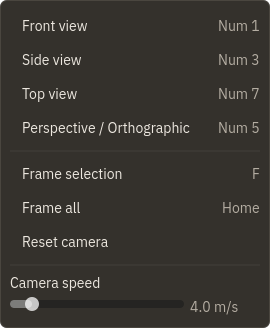

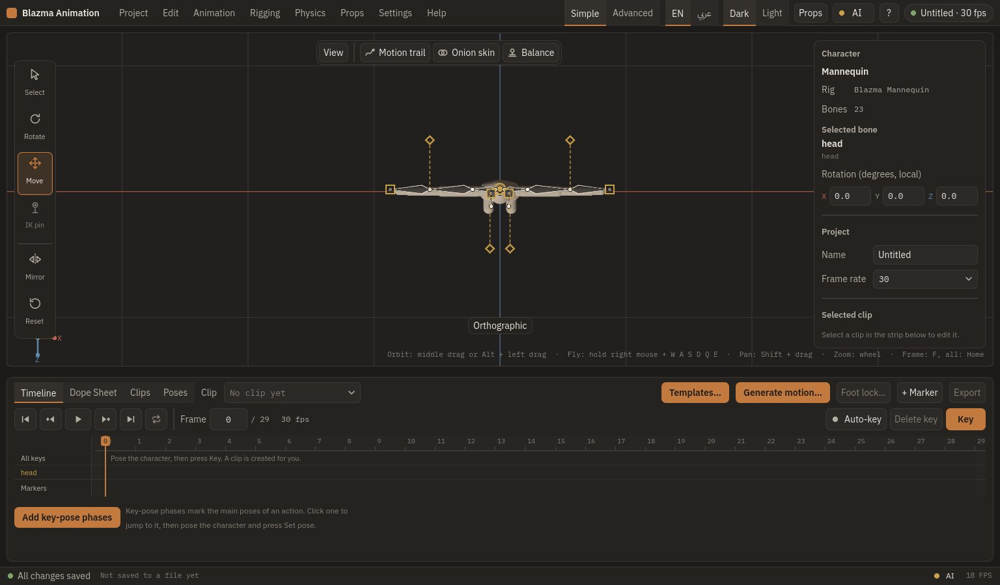

### Camera settings

**Settings > Camera Settings…** adjusts the fly speed, the field of view (30 to 100), **Invert vertical look**, and **Orbit around the selected bone** (the camera orbits the bone you selected instead of the scene centre).

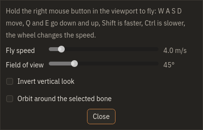

---

## 4. Posing a character

### Select, rotate, move

1. Click a joint on the character, or pick a bone in the **Rig** tree (Advanced mode). Its name and local rotation appear in the inspector, where you can also type exact values.
2. Choose a tool in the left toolbar: **Select (Q)**, **Rotate (E)** or **Move (W)**. Drag the gizmo to pose the bone. This is **FK** (forward kinematics): you rotate each joint.
3. Press **Key** (or turn on **Auto-key** so every change is keyed for you) to store the pose at the current frame. If no clip exists yet, one is created automatically.

### IK: pinning hands and feet

The small diamonds near the hands and feet are IK targets. Select a hand or foot and press **Shift+P** (or the **IK pin** tool, or Rigging > *Pin or Unpin Selected Hand or Foot*) to **pin** it: the limb now follows the target, so a planted foot stays planted while you move the pelvis. Move the target and the whole arm or leg follows (two-bone IK, with a pole target to steer the elbow or knee). **Rigging > Pin Both Feet** pins both feet in one go, and **Unpin All** releases them.

### Mirror

**Mirror (M)** flips the pose left to right. Use it to make a right-arm wave into a left-arm wave, or to build the second half of a walk from the first. **Reset** returns the selected bone, or the whole pose, to the rest pose.

### Copy, paste and the pose library

- **Ctrl+C / Ctrl+V** copy and paste a whole pose between frames or clips.
- The **Poses** tab is your pose library. Save the current pose under a name, then **Apply** it any time, on any frame. Poses can be renamed and deleted, and they are stored in the project file.

---

## 5. Timeline and keys

### Keys

A **key** stores a bone's pose at one frame. The animation is the blend between keys. The **All keys** row shows a diamond for every key in the clip, and the row below it shows the selected bone's keys.

| Action | How |
|---|---|
| Key the whole character | **Key** button or **K** |
| Key only the selected bone | **Shift+K** |
| Delete the key here | **Delete key** or **Alt+K** |
| Auto-key | Toggle **Auto-key** next to the Key button |
| Move the playhead | Click the ruler, or **Left / Right** to step a frame, **Home / End** for start / end |
| Previous / next key | **Up / Down** (or Alt+Left / Alt+Right) |
| Play / pause | **Space** |

### Interpolation

Between two keys the motion can be:

- **Cubic** — smooth ease-in and ease-out (the default for natural motion);
- **Linear** — constant speed;
- **Step** — holds the old pose and then snaps (good for blocking out poses).

In the **Dope Sheet**, select keys, right-click, and choose **Interpolation**.

### Dope Sheet and Graph editor

The **Dope Sheet** shows every bone's keys as rows. Drag to move keys, **Ctrl+C / Ctrl+V** to copy and paste, **Ctrl+A** to select all, **Delete** to remove.

The **Graph** tab (Advanced) shows each channel as a curve so you can reshape the motion itself. Drag keys and the Bezier handles of cubic keys. Press **F** or **Home** to frame the curves.

### Markers, key-pose phases and looping

- **+ Marker** adds a named flag at the playhead (for example "Contact"). Markers are saved in the export sidecar.
- **Add key-pose phases** adds the classic phase markers: Initial Pose, Anticipation, Main Action, Contact, Follow-through, Recovery, Final Pose. Click one to jump to it, pose the character, and press Key.
- **Loop** (the toggle in the inspector, and the loop button in the transport) makes the clip repeat; the loop range can be a part of the clip. Looping clips export as seamless cycles.

### Clips

The **Clips** tab lists every clip in the project as a card (name, frame rate, length). Click to select, double-click to rename, **+ New clip** to add one. The **Animation** menu can also create, rename and delete clips. Deleting always asks for confirmation.

---

## 6. Templates: ready-made motions

Press **Templates…** (below the timeline) for instant starting points: **Idle (breathing)**, **Walk cycle**, **Run cycle**, **Jump**, **Wave** and **Attack swing**. Pick one, choose the character and the length in seconds, and press **Apply to character**. A new clip is added and plays immediately. Everything is ordinary keys that you can edit.

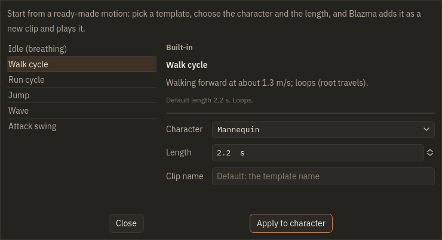

The built-in walk uses a gait model with IK-planted feet, so the feet do not slide. The chart below compares the old crude walk (left) with the current one (right):

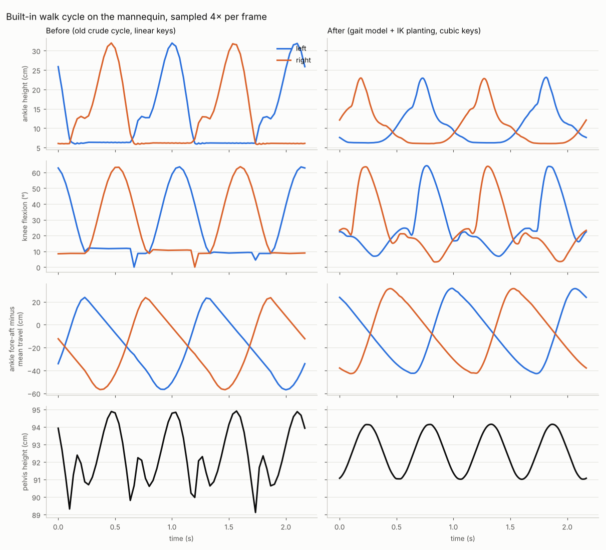

You can also save any clip you made as a **template** in your project library and apply it to another character later.

---

## 7. Generating motion from text

Describe a movement in plain words and Blazma builds a draft clip for you. The generator is **Kimodo**, an AI model that runs **entirely on your computer**. Nothing is sent over the internet, except when you choose to download the model files.

### Step 1: Download a model (one click)

Open **Settings > AI Models…** (or press **Generate motion…** the first time).

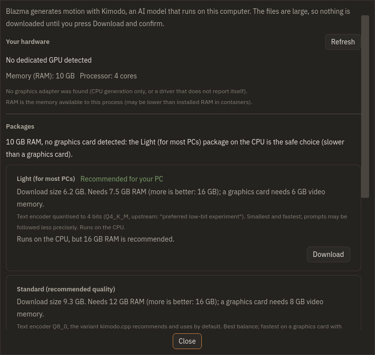

*(This screenshot was taken with tiny test packages, so the sizes shown are small. The real packages are 6.2, 9.3 and 16.3 GB.)*

The dialog detects your hardware (graphics card, RAM, CPU) and **recommends** a package:

| Package | Text encoder | Download | RAM (min / recommended) | Graphics memory (min / recommended) | Good for |
|---|---|---|---|---|---|
| **Light** | Q4_K_M | 6.2 GB | 7.5 / 16 GB | 6 / 8 GB | Modest PCs, CPU only |
| **Standard** | Q8_0 | 9.3 GB | 12 / 16 GB | 8 / 12 GB | A graphics card with 12 GB or more |
| **Reference** | BF16 | 16.3 GB | 20 / 32 GB | 16 / 20 GB | Very powerful machines |

All three use the same motion model; they differ in the size of the text encoder. Download sizes are in decimal units (1 GB = 1,000,000,000 bytes), the way Hugging Face and download pages state them, everywhere in the app; RAM and graphics memory are given the way Windows labels them ("16 GB RAM"). RAM figures are estimates, so every package stays selectable even if the dialog warns that it may be slow.

1. Press **Download** on a package.
2. Read and accept the model licences (NVIDIA Open Model License for the motion model, Meta Llama 3 Community License for the text encoder). Blazma will not download anything until you confirm.
3. Wait for the progress bar. Downloads **resume** if interrupted: press **Download** again and it continues from where it stopped. Each file is checked against its SHA-256 hash.

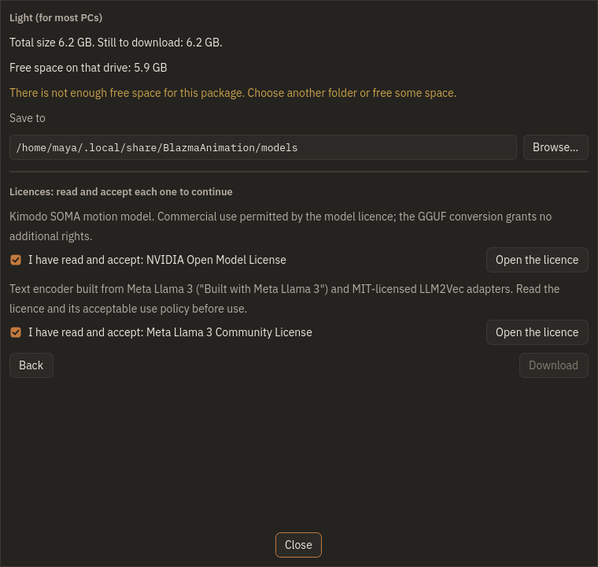

Files go to `%LOCALAPPDATA%\BlazmaAnimation\models` (or `userdata\models` in portable mode). They are large, so they are not placed in the roaming profile.

### Step 2: Choose where it runs: GPU, CPU, or both

In **Settings > Motion Generation (AI)…** pick the **Device**:

| Mode | Meaning |
|---|---|
| **Automatic (GPU first)** | Default. Tries CUDA (NVIDIA), then any Vulkan GPU (NVIDIA, AMD, Intel), then the graphics card with the text encoder on the processor, then the processor alone. If one attempt fails it falls back to the next and tells you |
| **Graphics card only** | Uses the GPU, and fails with a message if none is usable |
| **Processor only** | Always works, but is slower |
| **Graphics card + processor** | The text encoder runs on the processor and the motion model on the GPU. Choose this when your graphics memory is too small for the whole package |

The **Check** button lists the devices Blazma found. After each generation, the result shows a **"Generated on: …"** line so you always know what actually ran, for example "Generated on: the processor (CPU)", plus a warning if it had to fall back after a failed attempt.

#### Optional: GPU acceleration for NVIDIA cards (CUDA)

To keep the installer small (about 150 MB instead of about 460 MB), it ships the CPU and Vulkan backends only. NVIDIA cards work through Vulkan out of the box. CUDA is usually faster on NVIDIA, so when Blazma detects an NVIDIA card, **Settings > Motion Generation (AI)…** shows a **GPU acceleration (CUDA)** section with a **Download GPU acceleration (CUDA, ~550 MB)** button.

- Nothing is downloaded until you press the button (AI agents and the MCP/CLI tools can never start it). The file comes from the Blazma release on GitHub and is checked against the SHA-256 stored in the app before it is unpacked.
- It goes to `%LOCALAPPDATA%\BlazmaAnimation\runtime\cuda` (or `userdata\runtime\cuda` in portable mode) and needs about 1.5 GB of free space while it installs.
- A progress bar, speed and time left are shown; **Cancel** keeps what was downloaded and pressing the button again continues.
- Once installed, **Automatic** uses CUDA by itself. **Remove GPU acceleration** deletes it again (so does uninstalling Blazma).
- If a generation ran on an NVIDIA card through Vulkan, the "Generated on" line adds a tip pointing to this download.

### Step 3: Write your prompt

Press **Generate motion…** (below the timeline, or Animation menu).

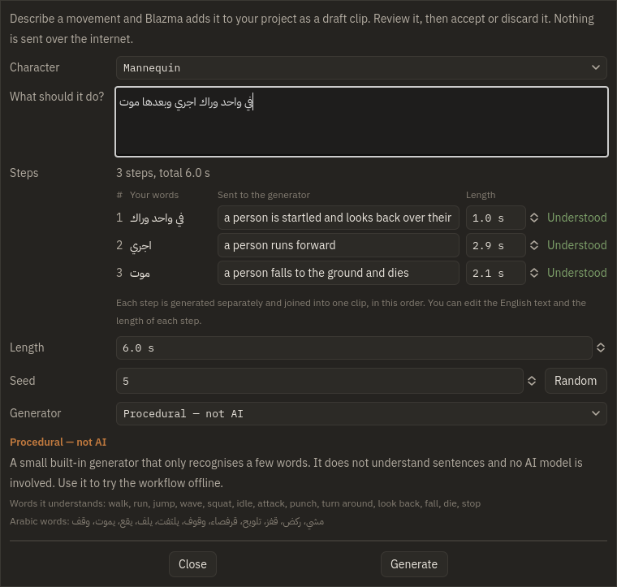

1. **Character** — who should move.
2. **What should it do?** — your description, in **English or Arabic** (including Gulf, Egyptian and Sudanese dialects).
3. **Length** — total seconds. **Seed** — the same seed with the same prompt gives the same result; **Random** picks a new one.
4. **Generator** — choose **Kimodo** (the AI model). The *Procedural — not AI* option is a tiny built-in generator that only recognises a few keywords; it is for trying the workflow offline.

Then press **Generate**. Progress is shown in the dialog and you can cancel at any time.

### Multi-step prompts

Kimodo makes one movement per description, and it understands English best. So Blazma first **plans** your text: it splits it into ordered **steps**, translates each to a clean English description, and divides the time between them. You see the plan as you type:

| Column | Meaning |
|---|---|
| **Your words** | The part of your text for that step |
| **Sent to the generator** | The English description Kimodo will receive. **Editable** |
| **Length** | Seconds for that step. **Editable** |
| Status | *Understood*, *Not understood* (rephrase it), or *Edited* |

Example: **«في واحد وراك، اجري، وبعدها موت»** ("there's someone behind you, run, and then die") becomes three steps: *a person is startled and looks back over their shoulder*, then *a person runs forward*, then *a person falls to the ground and dies*. Each step is generated on its own, then joined into **one draft clip** with a marker at the start of each step.

You can split steps with words such as *then, and then, after that, finally* (and in Arabic: ثم، بعدها، وبعدين، بعد ذلك، أخيرًا) or with commas and full stops. "While" and "وهو" do **not** split (two movements at once), and two verbs from the same family, such as "falls and dies", stay a single step.

More examples that work well:

- `a person walks forward, then looks back over their shoulder, then waves with the right hand`
- `يقفز ثم يجري للأمام ثم يقف`
- `يضرب لكمة قوية ثم يرجع لوضع الاستعداد`
- `a person jumps, then lands and crouches`
- `walks slowly for 4 seconds, then runs` (a duration such as "3 seconds" or «لمدة 3 ثواني» is respected)

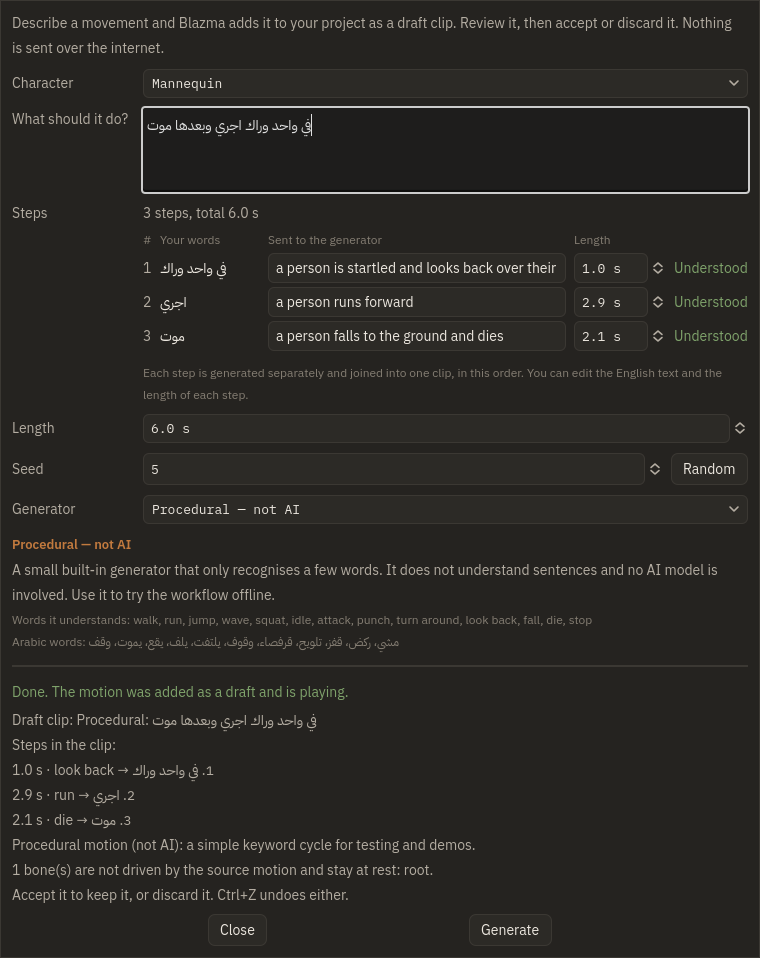

*(Shown with the procedural generator, which finishes instantly. Kimodo works the same way but takes longer.)*

### Drafts: accept or discard

The result arrives as a **draft** clip, marked "Draft" in the transport bar, and it starts playing. Nothing is permanent yet:

- **Accept** keeps it as a normal clip.
- **Discard** removes it.
- **Ctrl+Z** undoes either choice.

A multi-step draft has one **marker per step** on the timeline. Accepted clips are ordinary keys, so you can edit the keys, add a foot lock, retarget it or export it like any other clip.

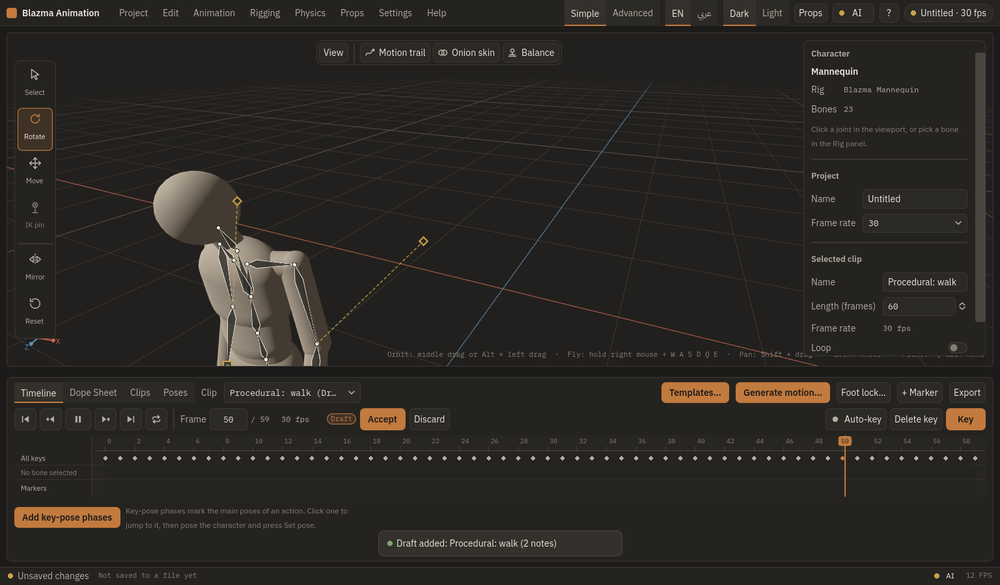

Real captures of generation with Kimodo on a CPU (Arabic interface):
[Demo 1](videos/demo-1.mp4) · [Demo 2: «في واحد وراك، اجري، وبعدها موت»](videos/demo-2.mp4) · [Demo 3](videos/demo-3.mp4) · [Demo 4](videos/demo-4.mp4)

[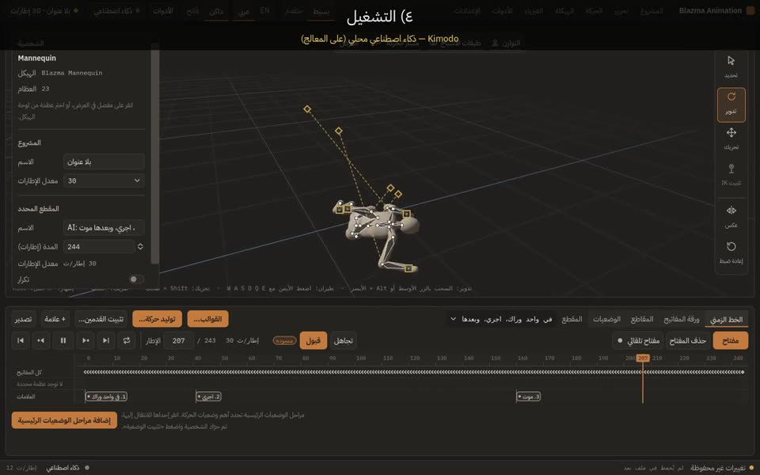](videos/demo-2.mp4)

### Tips for good prompts

- Describe **one clear action per step**, with the body part and direction: "a person punches forward with the right hand".
- Start simple, then refine. Use **Random** seed to get variations of the same prompt.
- Use the **editable English text** in the plan to fix a step that came out wrong.
- Prefer present-tense, third-person English: "a person jumps over an obstacle".
- Keep lengths realistic: a jump takes about 1 to 1.5 seconds, a punch about 1 second.
- Generation on CPU is slow (several minutes is normal). A graphics card is much faster.
- Generated motion is a draft that is meant to be **polished**: after accepting, use **Foot lock…**, the Graph editor, or the keys to clean it up.

---

## 8. Physics: balance and secondary motion

### Balance overlay

Press **Balance** in the strip above the stage. Blazma computes the character's **centre of mass**, the **support polygon** under the feet, and a signed **margin** (positive means inside, balanced). The 3D view shows them live, and a coloured **Balance strip** under the timeline shows every frame: green is balanced, red is not, yellow is borderline. The **Physics** panel summarises the clip (balanced, unbalanced and airborne frame counts, and the ranges that need attention).

Before and after auto-balance (a bent-over pose with the centre of mass outside the feet):

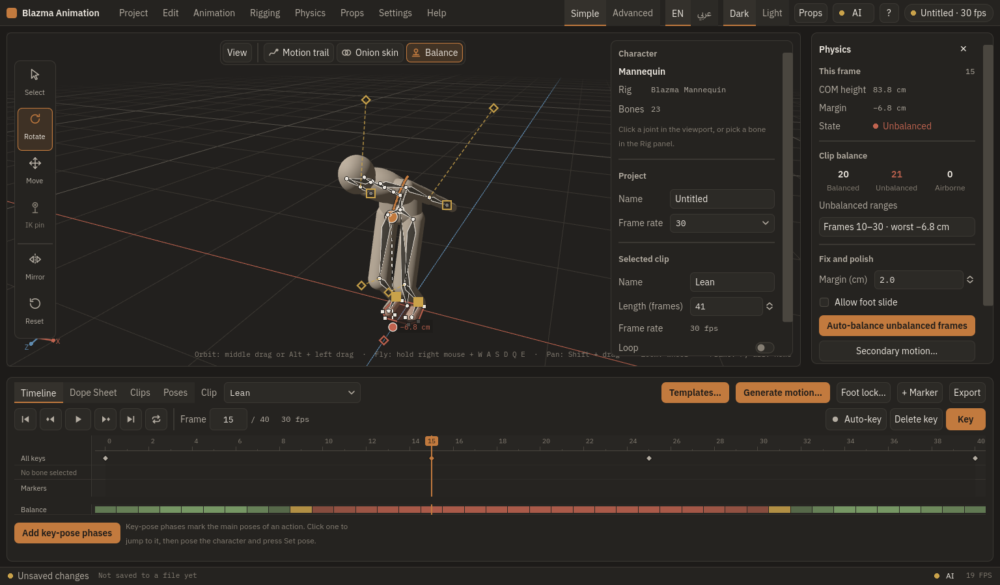 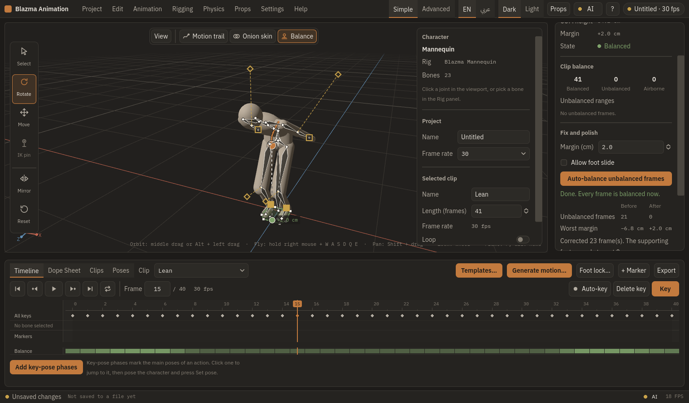

### Auto-balance

**Physics > Auto-balance Unbalanced Frames** shifts the pelvis horizontally by the smallest amount needed, while keeping the feet exactly where they are. Frames that were already balanced are not touched. If it cannot fix a frame without sliding a foot, it refuses rather than breaking the pose. It is one step in the history: **Ctrl+Z** restores the original. In the test clip, balanced frames went from 20 of 41 to 41 of 41.

### Secondary motion

**Physics > Secondary Motion…** adds follow-through and overlap, such as a ponytail, a cape or a swinging arm that lags behind the body. It uses a damped spring per bone, independent of the frame rate, with a limit on how far a bone may lag. Choose a **preset** (which bones follow through: the spine and head, only the head and neck, or both arms), set **Stiffness** (higher is snappier), **Damping** (higher settles faster) and the **maximum lag angle**, then press **Apply**. The result is written as ordinary rotation keys, so you can still edit them.

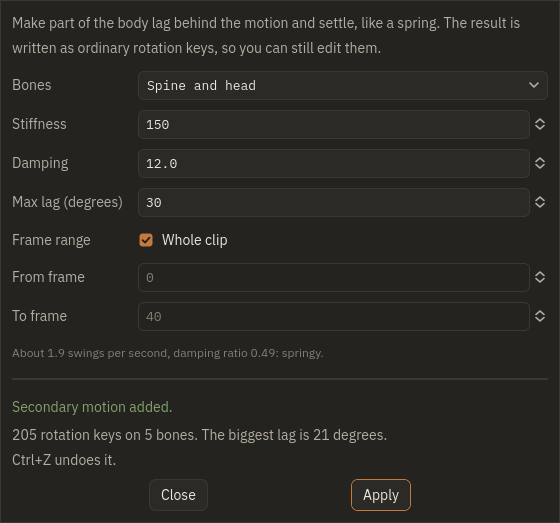

Physics tools assume a flat floor, and only the feet count as support.

---

## 9. Importing characters and retargeting

### Import a character

**Rigging > Import Character…** and choose a `.glb` file (glTF binary) with a humanoid skeleton. Blazma reads the skeleton and **maps its bones automatically** to its standard humanoid names (pelvis, spine, thigh, calf, upper arm and so on). A report tells you what matched and what did not.

If some bones did not map, or mapped wrongly, open **Rigging > Bone Mapping…** and assign them by hand: pick the model's bone on one side and the standard bone on the other. IK targets and joint limits are created from the mapping. Unmapped bones (fingers, face, extras) stay at rest.

Notes: only `.glb` files with embedded data are supported (a `.gltf` plus separate buffers is not). Exporting to an imported character keeps your original model (mesh, skin, materials) and adds your animation to it.

### Retarget a clip to another character

Animations made on the Mannequin can be copied onto an imported character with different proportions.

1. Press **Retarget…** (Advanced mode, below the timeline).
2. Choose the **clip to copy**, the character it plays on now, and the **character to copy onto**.
3. Keep **Lock the feet on the ground** ticked to prevent sliding.
4. Press **Retarget**. A new clip is added; the original is unchanged.

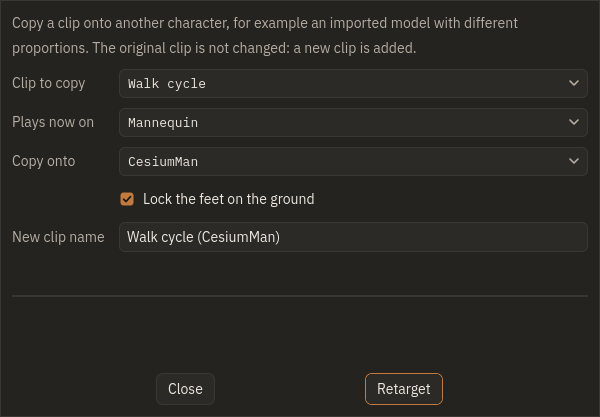

Each bone keeps pointing in the same direction as on the source, even if the rest poses differ (T-pose versus A-pose), and root motion is scaled by leg length. Retargeting works for mapped humanoid skeletons.

---

## 10. Foot lock

Feet that slide on the floor are the most common flaw in a walk or run. **Foot lock…** finds the frames where each foot rests on the ground and holds it at one spot there. Frames away from a contact are left exactly as they were.

1. Select the clip and press **Foot lock…** (or Animation menu).
2. Review the detected contacts. A strip under the timeline shows them (**Show Foot Contacts** toggles it).
3. Apply. **Ctrl+Z** undoes it.

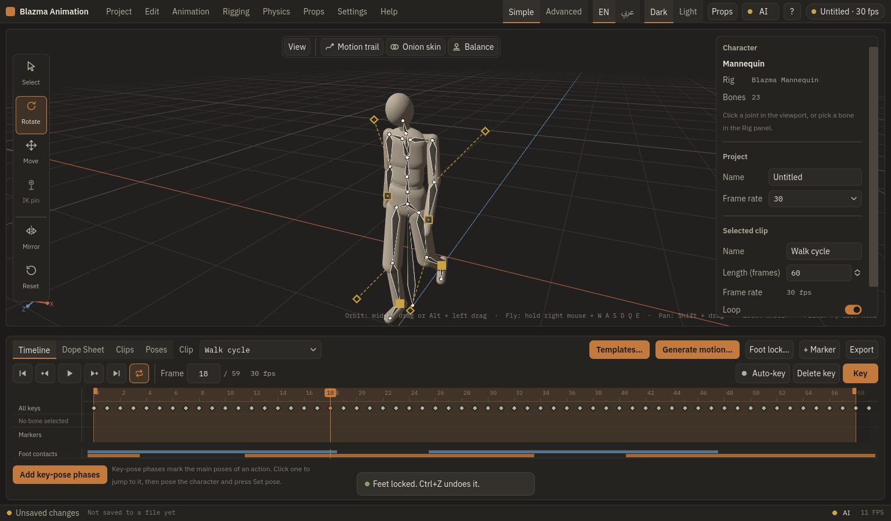

Foot lock assumes a flat floor, and works best on walking, running and idle motions.

---

## 11. Sequences and blending

Chain several clips into one long animation with smooth transitions. Open the **Sequence** tab (Advanced mode).

1. Create a sequence (**New…**) and add clips with **Add clip**. Each clip is a bar on a track you can drag.
2. Overlap two bars to blend them. The blend handle sets how long the transition is, and the curve (for example *Smooth*) its shape.
3. **Continue from the previous clip** keeps the character travelling from where the last clip ended, and **Keep facing** keeps the heading. **Match foot phase** aligns the stride when going from walk to run, so there is no hop. **Lock feet** applies foot lock to the result.
4. **Play** previews it in the 3D view. **Bake to clip** turns the sequence into an ordinary clip, and **Export…** writes it to a `.glb` directly.

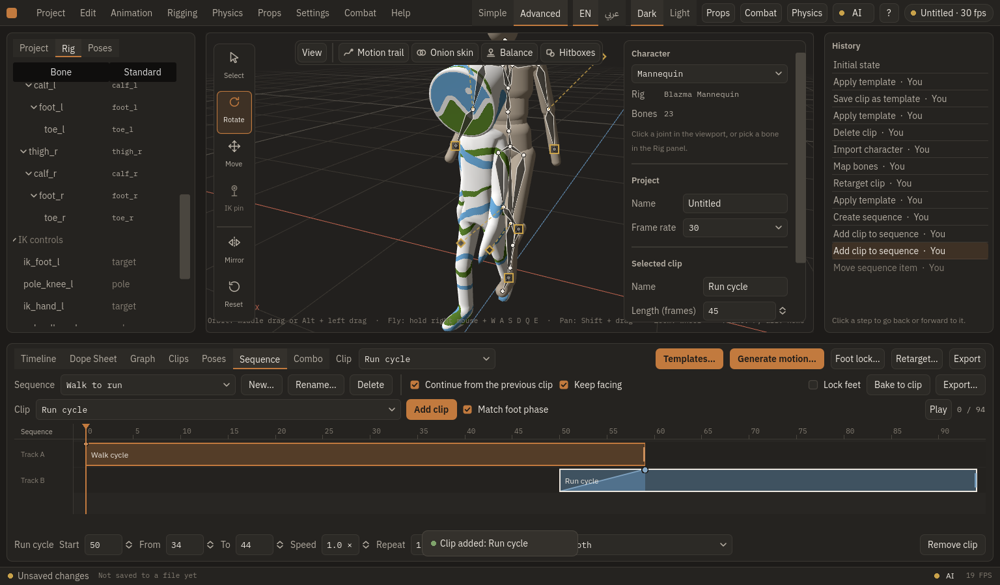

The same machinery joins the steps of a multi-step generated prompt.

---

## 12. Props

A prop is an object, such as a sword, a shield or a box, that moves with the animation.

1. Open the **Props** panel (the **Props** button in the top bar, or Props menu).
2. Add a **Box**, **Sphere** or **Cylinder** with the size you want (a sword is a thin cylinder, 0.05 x 0.9 x 0.05 m), or **Import .glb…** for a real model.
3. **Attach** it to a bone: choose the bone (for example `hand_r`) or select a bone and press **Use selected bone**. The prop now follows the hand.
4. Move and rotate the prop with the tools to set how it is held, and use **Key prop** to animate it (for example throwing it, or sheathing it).
5. Props are exported inside the `.glb`, under the bone they are attached to, and listed in the sidecar.

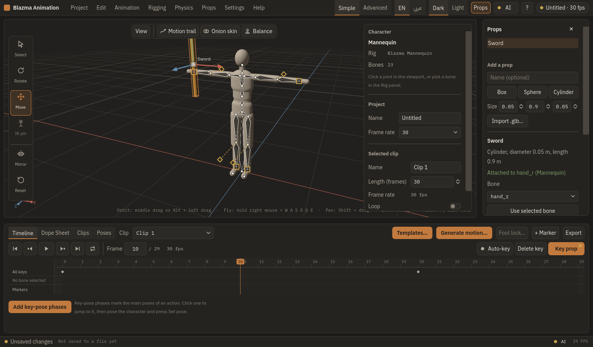

Delete a prop with the **Delete** key or Remove Prop. Props have no physics or collision.

---

## 13. Combat tools

For fighting games and action games. Open the **Combat** menu or the **Combat** panel (Advanced mode). The panel is for **one clip and one character**.

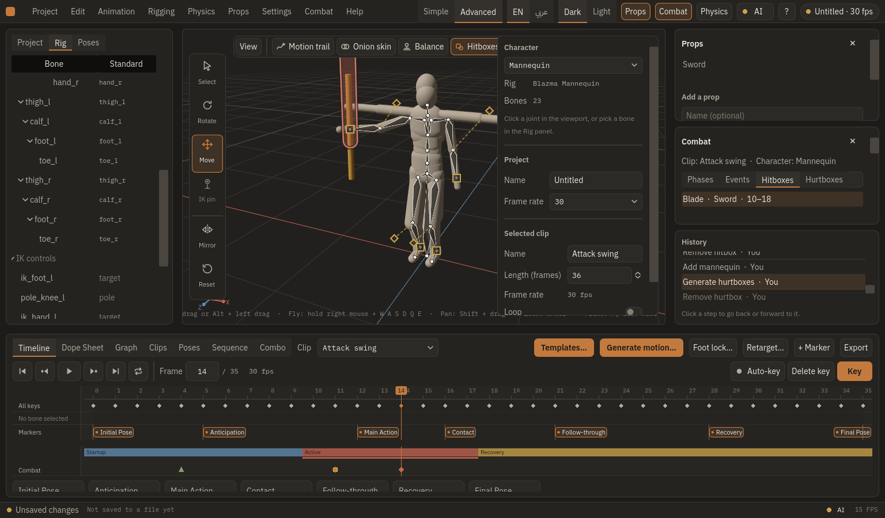

### Phases

Every attack has three phases: **Startup** (wind-up), **Active** (the part that can hit) and **Recovery**. Set them by hand, or let Blazma read them from the key-pose markers. They show as coloured bands on the **combat strip** under the timeline.

### Hitboxes and hurtboxes

- **Hitboxes** are the shapes that deal damage: a sphere, capsule or box attached to a bone or a prop (for example the sword blade). You set the **active frames**, **damage**, **knockback** and **hit-stop**.
- **Hurtboxes** are the shapes that can be hit. **Generate Hurtboxes** creates a set that covers a humanoid body (about 20 capsules) which you can then edit.

Press the **Hitboxes** toggle above the stage to see them. Hurtboxes are coloured by body zone, and hitboxes light up on their active frames.

### Events

**Add Event at Playhead…** adds a typed marker (hit, footstep, sound, vfx or custom) with a small payload. Game code reads them from the export.

### Hit test

**Hit Test…** swings the attack at a second character and tells you whether, when and where it hits.

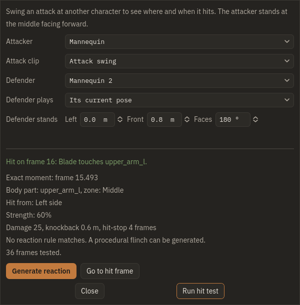

Set the attacker clip, the defender and where the defender stands and faces. The result gives the first **hit frame** (with the exact moment), the body part and zone, the side it came from, strength, damage, knockback and hit-stop. If the swing is very fast, the dialog warns that a very short touch may be missed, and suggests a slightly bigger hitbox. **Go to hit frame** jumps there.

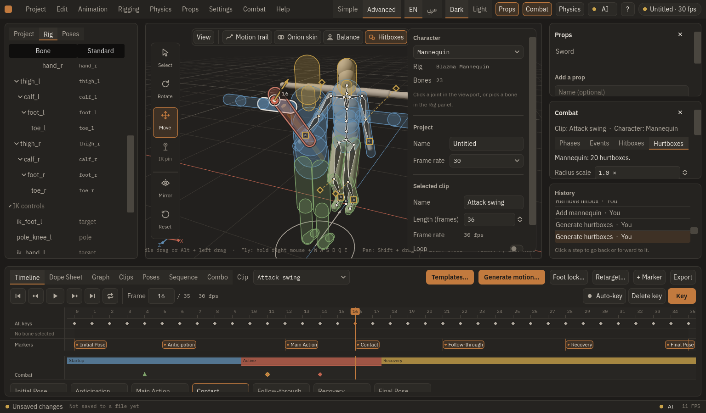

### Reactions

**Generate reaction** creates a flinch for the defender, bending away from the direction of the blow and returning to the base pose. You can also define rules by direction, height and strength. Procedural reactions affect the torso and head.

### Combos

The **Combo** tab (Advanced) chains attack clips into one combo: **Add attack** with an **Input** key (for example X or Y), then set a **cancel window** (the frames in which the next attack may interrupt this one). **Bake to clip** or **Bake to sequence** produces the final animation, with the cancelled attacks cut at the link.

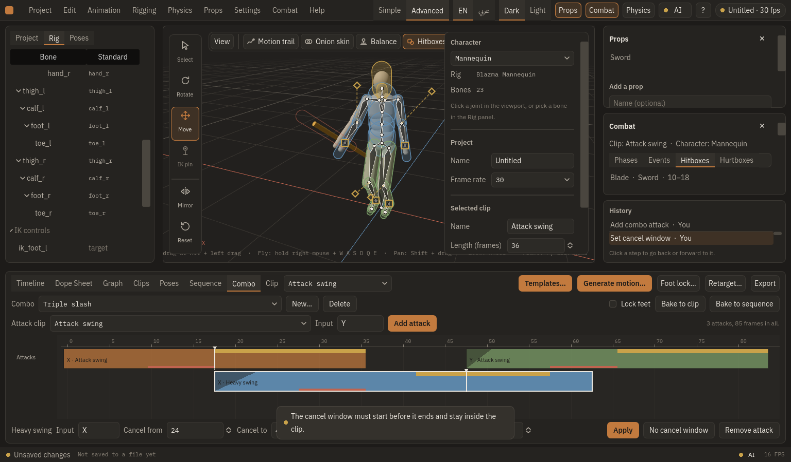

Combat data (phases, events, hitboxes, hurtboxes, rules and combos) is written to the export sidecar and checked after export.

---

## 14. Exporting to game engines

Press **Export** (or **Ctrl+E**, or Project > Export Animation…).

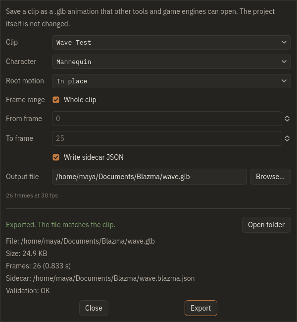

| Option | Meaning |
|---|---|
| **Clip** / **Character** | What to export |
| **Root motion** | **Keep** (as authored), **In place** (removes horizontal travel, keeps height — for engines that move the character themselves), or **In place, fully** (removes all displacement) |
| **Frame range** | The whole clip, or a range of frames |
| **Write sidecar JSON** | Also write `<name>.blazma.json` next to the file |
| **Output file** | Where to save (the **Browse…** button) |

After exporting, Blazma **re-opens the file and verifies** it against the clip. The dialog shows "Validation: OK", the size and frame count, and an **Open folder** button. If the file already exists you are asked before overwriting.

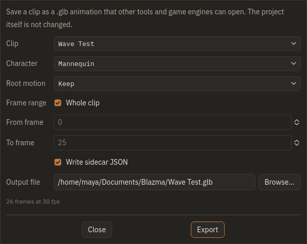

### What you get

- **`<name>.glb`** — glTF 2.0 binary. The animation is baked frame by frame (with IK solved) as linear channels. The built-in Mannequin is exported as a simple jointed figure (no skin). An imported character keeps its original mesh, skin and materials and receives your animation as an extra clip. Props are included.
- **`<name>.blazma.json`** (sidecar) — extra information that glTF cannot hold:
  - clip name, frame rate, start and end frame, duration;
  - **loop** range;
  - **markers** (including phase names);
  - **events** with their payloads (footstep, hit, sound...);
  - **root motion**: the mode, the removed displacement, per-frame deltas, and the displacement of one loop cycle, so your engine can move the character by the right distance;
  - the **bone list** with standard names and parents;
  - **combat data**: phases, hitboxes, hurtboxes, reaction rules and combos;
  - **props** and what they are attached to.

### In Godot and other engines

Import the `.glb` normally. Godot lists the clip as an animation of the imported scene; read the sidecar in your script to wire up footsteps, hit events and root motion. Godot removes constant channels on import; the data is complete in the file. Unity and Unreal can import the glTF through their glTF importers. FBX export is not available.

---

## 15. Saving, autosave and recovery

- **Ctrl+S** saves, **Ctrl+Shift+S** saves as, **Ctrl+O** opens, **Ctrl+N** starts a new project. Projects are single `.blazanim` files that contain everything: characters, clips, poses, props, combat data and any imported model.
- Saving is safe: the file is written, verified, and swapped in, and the previous version is kept beside it as a backup.
- **Autosave:** choose how often in the **Settings** menu (Off, every minute, 3, 5 or 10 minutes). It runs in the background without interrupting you.
- **Recovery:** if the app closes unexpectedly, the next launch offers **Recover unsaved work**. Pick the version you want.
- A project cannot be opened twice at the same time (for example in the app and by an external tool); you get a "project is locked" message.
- **Portable mode:** with `portable.txt` beside the program, settings, autosave and logs live in `userdata` beside it.

Where things are stored:

| What | Installed | Portable |
|---|---|---|
| Settings and autosave | `%APPDATA%\BlazmaAnimation` | `userdata\` |
| AI model files | `%LOCALAPPDATA%\BlazmaAnimation\models` | `userdata\models` |
| On Linux | `$XDG_DATA_HOME/BlazmaAnimation` (usually `~/.local/share/BlazmaAnimation`) | |

---

## 16. Connecting external AI tools (MCP / CLI)

Blazma includes tools that let an external AI assistant drive the app for you, for example **Claude Code** or **Codex**. This is optional.

- `tools\blazma-mcp.exe` — an **MCP server** that MCP-capable clients connect to.
- `tools\blazma-anim.exe` — a **command-line** tool for agents that run shell commands.

Short version for Claude Code:

```
claude mcp add blazma -- "C:\Blazma\tools\blazma-mcp.exe"
```

Open the **AI** panel in Blazma and check that **Agents allowed** is on. Choose **Assisted** (every task waits for your **Approve** or **Reject**) or **Autonomous**. Agents cannot run system commands, cannot read arbitrary files, and deletions always need your approval.

The full step-by-step guide (in Arabic) is [AGENT_SETUP_AR.md](AGENT_SETUP_AR.md). Reference lists: [MCP_TOOLS.md](MCP_TOOLS.md), [CLI_REFERENCE.md](CLI_REFERENCE.md), [AI_GUIDE.md](AI_GUIDE.md).

---

## 17. Troubleshooting and FAQ

**Windows says "Windows protected your PC" (SmartScreen).**
The app is not signed yet. Click **More info**, then **Run anyway**. Verify the download with `SHA256SUMS.txt`.

**"MSVCP140.dll was not found" when I generate motion.**
Install the Microsoft Visual C++ 2015–2022 x64 Runtime: <https://aka.ms/vs/17/release/vc_redist.x64.exe>. The installer does this for you; the portable zip does not.

**The app does not see my graphics card.**
Open **Settings > AI Models…** and press **Refresh**, or press **Check** in **Motion Generation (AI)…**. Update your graphics driver (NVIDIA drivers provide CUDA; any recent driver provides Vulkan). Set the device to **Automatic (GPU first)**; if a GPU attempt fails, Blazma falls back and tells you. As a safe choice you can always select **Processor only**. GPU generation is a recent feature (v0.11) and is still being validated on more hardware; reports are welcome.

**Generation is very slow.**
On CPU, one generation can take several minutes. Use a graphics card if you have one (Automatic or **Graphics card + processor**), pick the **Light** package on weak PCs, and generate a shorter clip. Close other heavy programs, because the models need a lot of memory. The time limit for one generation is configurable in the AI settings (default 15 minutes).

**The model download stopped or my connection dropped.**
Press **Download** again: it resumes from the partial file (`.part`) and verifies the hash at the end. If a file fails verification it is deleted and downloaded again.

**Where are my models and settings?**
See the table in section 15. You can delete a model folder to free space; the AI Models dialog will offer to download it again.

**My Arabic prompt says "not understood".**
Add a clear action verb (يجري، يمشي، يقفز، يقع، يموت، يلتفت، يلوح، يضرب...) or write that step in English in the **Sent to the generator** column.

**The generated motion looks wrong.**
Try another **Seed**, simplify the prompt to one action, edit the English text, or generate each step separately. Then clean up the result with keys and Foot lock.

**The mannequin's feet slide.**
Use **Foot lock…** (section 10), or pin the feet with IK (section 4).

**An imported character looks twisted.**
Check **Rigging > Bone Mapping…** and fix the left/right and arm/leg assignments.

**The exported animation travels away in my engine.**
Export with **Root motion: In place** and move the character in the engine using the sidecar's root-motion data.

**I opened the project twice.**
A project can be open in one place at a time. Close the other copy, or work on a duplicate.

**Is my work safe if the app crashes?**
Turn on Autosave in **Settings**. On the next start, use **Recover unsaved work**.

**Licence.**
Blazma Animation is proprietary software, all rights reserved by mr-kateba; see [LICENSE](../LICENSE). Bundled third-party components keep their own licences (see `THIRD_PARTY_NOTICES.md`).

---

## 18. Keyboard and mouse reference

### Mouse in the 3D view

| Input | Action |
|---|---|
| Right mouse (hold) | Fly (look around) |
| Middle mouse drag, or Alt + left drag | Orbit |
| Shift + drag | Pan |
| Wheel | Zoom (changes fly speed while flying) |
| Left click | Select a joint or prop |

### Keyboard

Press **F1** (or **?**) at any time for the shortcut cheat sheet: every shortcut by category, searchable, with a **Print…** button for a one-page printable copy. Shortcuts never fire while you type in a text field. Everything below can be changed in **Settings > Keyboard Shortcuts…** (see "Customising shortcuts" after the tables).

Some keys mean different things depending on where the focus is: **Home** frames everything while the 3D view has focus and jumps to the first frame everywhere else; **F** and the numpad views only work in the 3D view.

| Category | Keys | Action |
|---|---|---|
| **File** | Ctrl+N / Ctrl+O | New / open |
| | Ctrl+S / Ctrl+Shift+S | Save / save as |
| | Ctrl+E | Export animation |
| | Ctrl+Q | Quit |
| **Edit** | Ctrl+Z / Ctrl+Shift+Z (or Ctrl+Y) | Undo / redo |
| | Delete | Delete the selected prop or clip (asks first) |
| | Ctrl+D | Duplicate the clip |
| | A or Ctrl+A | Select all keys (Dope Sheet) |
| **Playback** | Space | Play or pause |
| | Left / Right | Previous / next frame |
| | Shift+Left / Shift+Right | Jump 10 frames |
| | Down / Up (or Alt+Left / Alt+Right) | Previous / next key |
| | Home / End | First / last frame (Home frames everything when the 3D view has focus) |
| | L | Loop on or off |
| **Keys** | I or K | Key the whole pose |
| | Shift+K or Shift+I | Key only the selected bone or control |
| | Alt+I or Alt+K | Delete the keys at this frame |
| | Ctrl+K | Auto-key on or off |
| **Tools** | Q / W / E | Select / Move (IK control, pelvis) / Rotate |
| | M | Mirror pose |
| | Shift+P | Pin or unpin the selected hand or foot |
| **Posing** | Alt+R | Reset the selected bone |
| | Alt+G | Reset the whole pose (asks first) |
| | Ctrl+C / Ctrl+V | Copy / paste pose (or keys in the Dope Sheet) |
| | Ctrl+Shift+V | Paste the pose mirrored |
| **View** | F or numpad . | Frame the selection (3D view) |
| | Home | Frame everything (3D view) |
| | Numpad 1 / 3 / 7 | Front / side / top view |
| | Numpad 5 | Perspective / orthographic |
| | T | Show or hide the side panels |
| | N | Show or hide the inspector |
| | ` (backtick) or Tab | Switch Simple and Advanced |
| | F11 | Full screen |
| | B | Balance overlay |
| | P | Motion paths (motion trail) |
| | O | Onion skin |
| **AI** | Ctrl+G | Generate motion… |
| | Ctrl+T | Templates… |
| **Help** | F1 or ? | Shortcut cheat sheet |
| | Shift+F1 | Tutorial |
| **Flying** (right mouse held) | W A S D / Q E | Fly forward, left, back, right / down, up |
| | Shift / Ctrl | Faster / slower |

> There is no Scale tool: the mannequin and imported rigs are posed by rotation, IK moves and the pelvis, not by scaling bones.

### Customising shortcuts

Open **Settings > Keyboard Shortcuts…** (or **Help > Customise Shortcuts…**).

- **Search** by action name, category or key.
- **Click** a key, then press the new shortcut. **Esc** cancels. **×** removes a shortcut and **↺** goes back to the default.
- If the key is already used by another action in the same place, a **warning** names it and asks whether to **Replace** it (that action is left without a key) or **Cancel**. The same key may be used by two actions only when they work in different places (for example Home in the 3D view and on the timeline).
- **Reset all to defaults**, **Export…** and **Import…** (a small JSON file) let you back up your keys or share them between computers.
- Your choices are saved with your settings, so they follow the portable folder too. Menus, buttons and tooltips show your current keys.
