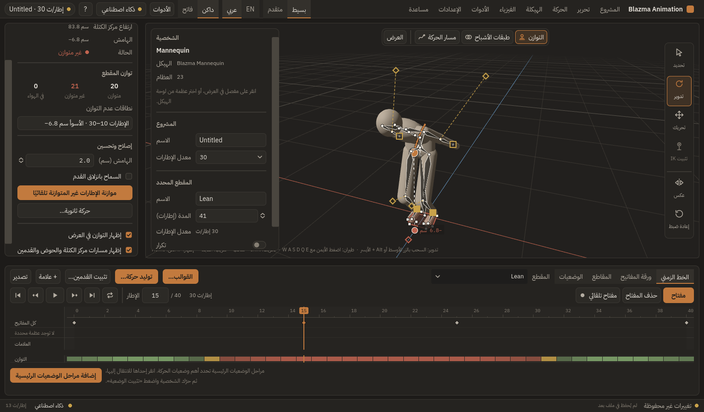
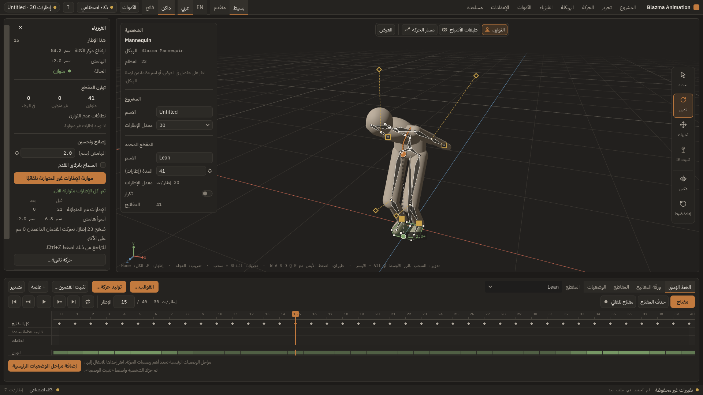

# تقرير المرحلة 6 — الفيزياء المساعدة

التاريخ: 2026-10-17 · الحالة: **مكتملة**

## معيار القبول
> تصحيح حركة اختبارية مع مقارنة قبل/بعد.

حركة اختبارية (41 إطارًا، القدمان مثبتتان، انحناء الجذع 60° مع دفع الحوض للأمام):

| | قبل | بعد «موازنة الإطارات غير المتوازنة تلقائيًا» |
|---|---|---|
| إطارات متوازنة | 20 / 41 | **41 / 41** |
| أسوأ هامش | −6.8 سم (الإطار 15) | +2.0 سم |
| حركة القدمين | — | 0 |
| الإطارات خارج نطاق التصحيح | — | دون تغيير (< 1e-9) |

التراجع (Ctrl+Z) يعيد المقطع حرفيًا، والإعادة تعيد التصحيح حرفيًا. مُثبت باختبار نواة واختبار واجهة يضغط الزر الحقيقي.

## ما تم تنفيذه
- **مركز الكتلة:** كتل ونسب Winter لكل جزء؛ للشخصيات المستوردة البشرية نفس النسب، ولغيرها توزيع حسب الطول مع تحذير.
- **منطقة الارتكاز:** 5 نقاط لكل قدم، كشف التلامس بالارتفاع والسرعة، Convex hull، هامش بإشارة (موجب داخل).
- **مقاييس التوازن:** إسقاط مركز الكتلة، ZMP، Capture point. حالة «في الهواء» لا تُحسب خطأ.
- **الموازنة التلقائية:** تحريك الحوض أفقيًا بأقل قدر مع إبقاء القدمين؛ ساق IK تُحل بالـ IK، وساق FK تحافظ على مستوى الركبة. يرفض بدل أن يُزلق القدم.
- **المسارات:** مركز الكتلة، الحوض، القدمان.
- **الحركة الثانوية:** نابض مُخمَّد لكل عظمة، مستقل عن معدل الإطارات، مع حد للتأخر.
- **الواجهة:** قائمة «الفيزياء»، طبقة رسم في العرض، شريط توازن ملوّن في الخط الزمني، لوحة الفيزياء، نافذة الحركة الثانوية.
- **للوكلاء:** `physics_analyze`، `physics_com`، `physics_auto_balance`، `physics_secondary_motion`، `physics_trajectories`.

## المراجعة
3 جسيمة و4 متوسطة و5 صغيرة، صُحّحت كلها مع اختباراتها: تسرّب التعديل لإطارات لم تُصحَّح، قفز الركبة في FK، تجميد البرنامج بطلب ضخم، كتل الشخصيات المستوردة، اتجاه القدم، العظام المقفلة في الحركة الثانوية، القيم غير المنتهية.

## الاختبارات
- النواة: 502 ✅ · الواجهة: كلها ✅

## قيود معروفة
- الأرض مستوية، والقدمان فقط تُحسبان كارتكاز.
- الموازنة تحرّك الحوض فقط (لا ميل للعمود الفقري).
- الحركة الثانوية دوران فقط وبدون تصادم.
- التحليل يُعاد عند كل تعديل؛ قد يتقطع السحب في المقاطع الطويلة جدًا.
- طبقة الرسم ثنائية الأبعاد فوق المشهد (بلا إخفاء بالعمق).
